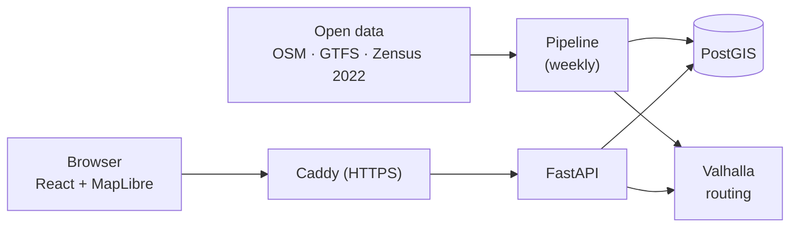

# reach — 15-Minute City Tübingen

`reach` measures how well residents of Tübingen can reach everyday services — supermarkets,
pharmacies, doctors, childcare, schools, parks, playgrounds, public transport — within 15 minutes on foot,
by bike or by wheelchair. It shows underserved areas on an interactive map and recommends
where new facilities would help the most people.

Course project for **DS500 Data Science Project** (M.Sc. Data Science in Business and Economics,
University of Tübingen, winter term 2026/27), Topic 9 "The 15-Minute City".

> **Status: P7 (recommender and validation report) in review (6 Nov 2026).** The local stack
> (PostGIS, Valhalla, API, web app behind Caddy), configuration, CI, the whole pipeline, the API
> and the web app exist: `acquire` downloads OSM, GTFS and Zensus data, `validate` turns them
> into checked layers, `make refresh` builds the Valhalla routing graph, `count` computes
> reachable facilities per cell, category and profile plus public transport departures,
> `recommend` ranks 100 m zones for new facilities, `validate_results` checks the results,
> `publish` loads each validated run into PostGIS and switches the `current` views to it, the
> API serves the results as GeoJSON plus live isochrones and routes, and the web app shows the
> class map, a pin-drop inspector, recommended sites with their catchments, district statistics,
> map settings (layers, cell opacity, isochrone rings and direction, minimum residents, pin mode),
> facility pins with a route to the next missing facility (also beyond 15 minutes) and a clickable
> facility list with opening hours, address and links to OpenStreetMap and Google Maps, park outlines
> with their access points, and the data & validation page. The app iteration on 18 feedback points (plan: [`docs/app_iteration_plan.md`](docs/app_iteration_plan.md)) is in
> progress. The validation experiments V1–V11 run with `make experiments`
> and are interpreted in [`docs/validation_report.md`](docs/validation_report.md) (V7 and V9
> need people and are not run yet); progress:
> [`docs/implementation_plan.md`](docs/implementation_plan.md).

## What it does

- **Accessibility map** — 15-minute reachability per facility category and travel profile on the
  official Zensus 2022 100 m grid, aggregated to city districts.
- **Public transport supply** — scheduled weekday departures at stops within a 10-minute walk.
- **Pin-drop inspector** — click anywhere in the city: what is reachable, how long it takes,
  which category is the weakest, and whether the cell is scored, has no residents or lies outside
  the city boundary.
- **Recommendations** — 100 m zones for one new facility per category and profile (walking,
  wheelchair), ranked by the reduction of unmet demand (greedy, methodology §5); a click shows
  the residents who would reach it within 15 minutes.
- **Automated and validated** — a weekly pipeline downloads open data, validates it and publishes
  new results only if all checks pass; scripted experiments (V1–V11) test the method itself
  ([validation report](docs/validation_report.md)).

## Architecture in one picture



Valhalla is the single routing engine for counting, isochrones and live queries. Everything runs
with Docker Compose on one small server. Details: [`docs/architecture.md`](docs/architecture.md).

## Repository layout

| Path | Content | Status |
|---|---|---|
| `docs/` | Architecture, methodology, validation report (with `figures/`), features, glossary, notes, team decisions | ✅ |
| `AGENTS.md`, `CLAUDE.md` | Rules for coding agents | ✅ |
| `CONTRIBUTING.md` | Branches, commits, pull requests, releases | ✅ |
| `CHANGELOG.md` | Change history | ✅ |
| `pipeline/` | Data pipeline (Python, uv workspace member): stages `acquire`, `validate`, `tiles`, `count`, `score`, `recommend`, `validate_results`, `publish`, `cleanup`; validation experiments V1–V11 (`reach_pipeline.experiments`) | ✅ |
| `api/` | FastAPI backend (Python, uv workspace member): read endpoints from `current`, live endpoints via Valhalla | ✅ |
| `web/` | React + TypeScript + MapLibre frontend (npm): class map, inspector, recommended sites with catchments, districts, map settings, data & validation page | ✅ |
| `config/` | Study area, profiles, categories, thresholds (`config.yaml`), test clip, Valhalla service config (`valhalla.json`), validation experiments (`experiments.yaml`) | ✅ |
| `infra/` | Caddyfile; `api.Dockerfile`, `web.Dockerfile` (web build in the Caddy image); `db/`: roles, migrations, run schema template; pipeline image, scheduler planned | partial |
| `Makefile`, `compose.yaml`, `.env.example` | Local stack (incl. Valhalla and its one-shot tile build) and command wrappers | ✅ |
| `tests/integration/` | Golden travel times against a local Valhalla on the test clip | ✅ |
| `.github/` | CI (lint + tests; PostGIS data-contract test; web lint, build and browser smoke test), issue/Project sync, PR template, CODEOWNERS | ✅ |

## Getting started

Requirements: [uv](https://docs.astral.sh/uv/), Docker (Desktop) with Compose,
[osmium-tool](https://osmcode.org/osmium-tool/) ≥ 1.16 for the pipeline and its tests (tested with
1.19.1 from Homebrew and 1.16 from Ubuntu 24.04 apt: `brew install osmium-tool` /
`sudo apt-get install osmium-tool`), Node.js 24 LTS for frontend development (`web/.nvmrc`; `make up`
builds the app in Docker without it). Without uv:
`pip install -r requirements.txt` (exported from `uv.lock`).

```bash
git clone https://github.com/IsochroneLabs/reach.git
cd reach
git switch dev

uv sync                 # Python 3.12 environment (.venv) for pipeline and api
make test               # unit tests (uv run pytest; integration tests are deselected)
make lint               # ruff check + format check

cp .env.example .env    # then replace every "change-me" (also inside the DATABASE_URL_* lines)
make up                 # start PostGIS, API, Caddy with the web app (+ Valhalla once tiles exist)
make migrate            # once: DB roles (passwords from .env), meta schema, migrations
make refresh            # new run: acquire (~350 MB) → validate → build Valhalla tiles if the
                        # clipped OSM changed → swap + restart Valhalla → tiles verify → count
                        # → score → recommend → validate_results → publish → cleanup
make pipeline STAGE=count     # one stage against the running Valhalla (latest run)
make pipeline           # all stages without a tile rebuild (needs the tiles of a first refresh)
make valhalla-config    # recreate Valhalla if config/valhalla.json changed (up, refresh and
                        # pipeline do this; count fails if Valhalla runs another config)
make experiments        # validation experiments V1–V11 on the latest run (RUN_ID=… for another):
                        # results in data/experiments/<run_id>/, figures in docs/figures/; V2
                        # fetches the city's Kita and school pages once (cached in data/reference/),
                        # V11 builds and serves a temporary elevation-free tile set on port 8005
make down               # stop the stack
```

**Open the app:** after `make up` and a published run (`make refresh`), open
<http://localhost:8080> — map, selectors, inspector (click the map), recommended sites (click a
ranked marker or list entry for its catchment), district panel and the
*Data & validation* page. A link can preset the view, e.g.
`http://localhost:8080/#/map?profile=walking_339&category=grocery`. Frontend development with hot
reload (Node 24):

```bash
cd web && npm ci
npm run dev             # http://127.0.0.1:5173, proxies /api to the stack at :8080
npm run lint && npm run build
npx playwright install chromium   # once
npx playwright test               # browser smoke test against recorded API responses
E2E_LIVE=1 npx playwright test    # the same test against http://localhost:8080
```

A second `acquire` skips unchanged downloads and hard-links the files of the previous run. The
test clip uses its own data directory: `REACH_CONFIG=config/test_clip.yaml make pipeline`.
`validate` needs about 2.5 GB of RAM at peak on macOS and about 4 GB on Linux (`osmium extract`,
grows with the highest OSM node ID); see the risks in the implementation plan.

Outputs of a run: `data/runs/<run_id>/validate/report_inputs.md` (input checks),
`count/access_counts.parquet`, `count/reachable.parquet` (facilities within the budget per
cell), `count/transit_supply.parquet` and `count/report_count.json`
(runtime, matrix sizes, prefilter evidence), `validate_results/report_results.md` (result
checks, residents per class, sample cells, matrix vs. /route as a known limitation). `publish` loads the run into the PostGIS schema
`run_<id>` and points the `current` views (`scores`, `transit_scores`, `district_scores`, …) at
it in one transaction; `cleanup` keeps the last 3 published runs (schemas and `data/` folders).
`make` passes `.env` to the pipeline; set `DATABASE_URL_ADMIN` there for `make migrate`. The tile build (`valhalla-build`, official Valhalla
image) downloads elevation tiles once into `data/valhalla/elevation/`; tiles are swapped with
`mv`, the previous ones kept as `valhalla_tiles.prev.tar`. A full count of Tübingen takes about
3.5 minutes on a laptop; Valhalla then holds up to ~3 GB of RAM (`docs/notes.md` N4).

API (through Caddy at `http://127.0.0.1:8080/api/…` after `make up` and a published run;
response formats in [`docs/data_contract.md`](docs/data_contract.md)):

```bash
curl -s http://127.0.0.1:8080/api/meta                                   # run, data dates, validation
curl -s "http://127.0.0.1:8080/api/cells?category=grocery&profile=walking_339"   # GeoJSON
curl -s http://127.0.0.1:8080/api/districts                              # GeoJSON
curl -s "http://127.0.0.1:8080/api/districts/<district_id>/scores?profile=walking_339"
curl -s -X POST http://127.0.0.1:8080/api/inspect -H 'content-type: application/json' \
     -d '{"lon": 9.0568, "lat": 48.5204, "profile": "walking_339"}'      # pin-drop inspector
curl -s -X POST http://127.0.0.1:8080/api/catchment -H 'content-type: application/json' \
     -d '{"facility_id": "n12004391663", "profile": "walking_339"}'      # residents reaching it
curl -s -X POST http://127.0.0.1:8080/api/route -H 'content-type: application/json' \
     -d '{"lon": 9.0568, "lat": 48.5204, "profile": "walking_339", "facility_id": "n12004391663"}'  # route to one facility
curl -s -X POST http://127.0.0.1:8080/api/expansion -H 'content-type: application/json' \
     -d '{"lon": 9.0568, "lat": 48.5204, "profile": "walking_339"}'      # street spread
```

The API image is built from `infra/api.Dockerfile` by `make up`; locally `api/src` and
`config/` are mounted and uvicorn reloads on changes. Tunable values (cache sizes, rate limit,
isochrone contours) live in the `api` section of `config/config.yaml`.

Test clip: `make refresh REACH_CONFIG=config/test_clip.yaml` (own data and tile directory under
`data/test_clip/`, tiles without elevation), then `uv run --env-file .env pytest -m integration`
runs the golden travel-time tests against it (the pipeline has no default Valhalla URL, so
`VALHALLA_URL` must come from `.env`). The test clip publishes into the same local database and replaces
`current`. Database contract tests: `REACH_TEST_DATABASE_URL=postgresql://postgres:<password>@localhost:<DB_PORT>/postgres
uv run pytest -m db` (creates and drops its own database; CI runs it in the `db-contract` job). Switching back: `make up` (or `make refresh`) with the default
config. If port 5432, 8002 or 8080 is taken on your machine, change `DB_PORT`, `VALHALLA_PORT` or
`WEB_PORT` in `.env`, and the same port in `DATABASE_URL_PIPELINE`, `DATABASE_URL_ADMIN` (for
`DB_PORT`) and `VALHALLA_URL` (for `VALHALLA_PORT`); the app is then at
`http://localhost:<WEB_PORT>`. A **second checkout** on the same machine also needs its own
`COMPOSE_PROJECT_NAME` in `.env`: `compose.yaml` names the project `reach`, so without it the
second `make up` replaces the containers of the first (images `reach-api:dev` and
`reach-web:dev` are shared either way).

## Data sources

| Source | Used for | Licence |
|---|---|---|
| [Geofabrik](https://download.geofabrik.de/europe/germany/baden-wuerttemberg/tuebingen-regbez.html) OpenStreetMap extract | Street network, facilities (with opening hours, wheelchair access, address and contact tags as displayed information), boundaries, land use | ODbL 1.0 |
| [NVBW](https://www.nvbw.de/open-data/fahrplandaten) GTFS (naldo) | Public transport stops and departures | dl-de/by-2-0, ODbL |
| [Destatis Zensus 2022](https://www.zensus2022.de/) 100 m grid | Residents per cell | dl-de/by-2-0 |
| Elevation tiles via Valhalla | Slopes (per-profile setting) | per source |
| [OpenFreeMap](https://openfreemap.org/) Positron (OpenMapTiles schema) | Basemap of the web app (no key) | © OpenMapTiles, © OpenStreetMap contributors (ODbL) |
| [Universitätsstadt Tübingen](https://www.tuebingen.de/kindertageseinrichtungen) Kita and school pages | Reference list for the OSM completeness check (V2), fetched once, kept locally | none stated; validation only, not redistributed |

© OpenStreetMap contributors · © Statistisches Bundesamt (Destatis) · NVBW.

## Documentation

| Document | Content |
|---|---|
| [`docs/architecture.md`](docs/architecture.md) | **Binding** system description, decisions and change log |
| [`docs/methodology.md`](docs/methodology.md) | **Binding** categories, thresholds, scoring, recommender, validation experiments |
| [`docs/data_contract.md`](docs/data_contract.md) | Table and file schemas between pipeline and API (draft) |
| [`docs/validation_report.md`](docs/validation_report.md) | Validation experiments V1–V11: method, result, interpretation, limitations |
| [`docs/features.md`](docs/features.md) | Features, priorities and roadmap |
| [`docs/glossary.md`](docs/glossary.md) | Project vocabulary |
| [`docs/notes.md`](docs/notes.md) | Open points and future work |
| [`docs/implementation_plan.md`](docs/implementation_plan.md) | Phase plan, status and decisions of the implementation (handoff between sessions) |
| [`docs/prompts/implementation.md`](docs/prompts/implementation.md) | Prompts for building the system with a coding agent, phase by phase |
| [`docs/prompts/app_iteration.md`](docs/prompts/app_iteration.md) | Approvals block and master prompt that let a coding agent build W1–W8 of the app iteration |
| [`docs/github_tracking.md`](docs/github_tracking.md) | Plan task metadata, issue/Project sync permissions, and bootstrap steps |
| [`docs/app_iteration_plan.md`](docs/app_iteration_plan.md) | Work packages W1–W8 for the app feedback round (18 points), decisions and agent prompt |
| [`docs/osm_tagging.md`](docs/osm_tagging.md) | How facilities are tagged in OSM, which tags the pipeline reads, how we improve OSM data |
| [`docs/project_management_decisions.md`](docs/project_management_decisions.md) | Team and course organisation |
| [`CONTRIBUTING.md`](CONTRIBUTING.md) | How we work together |
| [`AGENTS.md`](AGENTS.md) | Rules for coding agents |

## Team

| Name | GitHub |
|---|---|
| Rico | [RicoS03](https://github.com/RicoS03) |
| Socke | [konstantinholl](https://github.com/konstantinholl) |
| Juju | [nicholas-tuebi](https://github.com/nicholas-tuebi) |

## Milestones

| Date | Milestone |
|---|---|
| 25 Nov 2026 | Interim presentation (`v0.1.0`) |
| 22 Jan 2027, 23:59 | Submission: code, documentation, video (`v1.0.0`) |
| 29 Jan 2027 | Final presentation |
