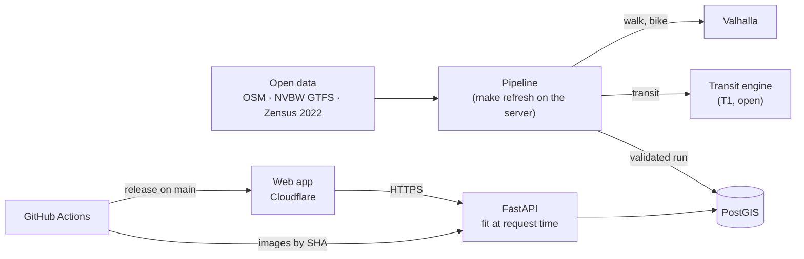

# reach

reach helps students who are new to Tübingen decide where to live, by showing how long their own
everyday trips take from each part of the city on foot, by bike (with hills) and by bus, and
explaining the differences in plain language.

Course project DS500, University of Tübingen.

## Status

Rebuild started on 21 Nov 2026; this repository holds the plan and the sources of truth, the code
follows step by step. Progress, the next step and open decisions:
[`docs/implementation_plan.md`](docs/implementation_plan.md).

[](https://github.com/IsochroneLabs/reach/actions/workflows/ci.yml)
[](https://github.com/IsochroneLabs/reach/actions/workflows/deploy.yml)

The previous project, an accessibility planner for the whole city, is archived in the locked
branch [`archive/2026-11-21-planner`](https://github.com/IsochroneLabs/reach/tree/archive/2026-11-21-planner).
The rebuild reuses its engineering (pipeline core, Valhalla routing, PostGIS, API skeleton), not
its framing.

## What it does

A student answers a few questions (programme, hobbies, how they get around, what matters how
much, optional budget) and gets:

- **Explore (U1):** a map of Tübingen with the areas that fit them best, each with reasons such
  as "Morgenstelle 12 min by bus at 8:00, climbing gym 8 min by bike, last bus home after
  midnight".
- **Check a place (U2):** an address or a pin (e.g. a WG listing) → their trips from there on
  foot, by bike and by bus, with times, and how well the place fits their profile.
- **Compare (U3):** two or three places side by side.

Times depend on when a trip happens (first lecture, evening, night home, weekend to the
station). The answers stay in the browser; nothing personal is stored on a server. Details:
[`docs/product.md`](docs/product.md).

## Architecture in one picture



The pipeline stores raw travel times per cell, destination, mode and trip window; the API turns
them into a personal fit and reasons for each request. More: [`docs/architecture.md`](docs/architecture.md).

## Repository layout

| Path | Content | Status |
|---|---|---|
| `docs/` | Product, architecture, methodology, data contract, deployment, glossary, notes, plan | drafts |
| `config/` | `config.yaml` (all tunable values), `campus.yaml`, `personas.yaml` | drafts |
| `pipeline/` | Data pipeline (Python, uv): acquire, validate, tiles, publish, cleanup | skeleton (S0.4); travel times S1.8 |
| `api/` | FastAPI service: health | skeleton (S0.4); endpoints S1.10 |
| `web/` | Student web app (React, TypeScript, Vite; MapLibre from Phase 2), deployed to Cloudflare | placeholder (S0.5) |
| `infra/` | API and pipeline Dockerfiles, DB roles, migrations and run schema; server files *planned, S1.5* | partly |
| `.github/` | CODEOWNERS, PR template, workflows `ci.yml` and `deploy.yml` | S0.5 |

## Getting started

Needs Docker with Compose, [uv](https://docs.astral.sh/uv/) and
[osmium-tool](https://osmcode.org/osmium-tool/); the web app needs Node.js 24 (`web/.nvmrc`). Copy
`.env.example` to `.env` and replace every `change-me`.

```bash
uv sync                                                # Python environment
uv run ruff check . && uv run ruff format --check .   # lint
uv run pytest                                          # unit tests
make refresh REACH_CONFIG=config/test_clip.yaml        # pipeline on the ~1 km² test clip
cd web && npm ci && npm run dev                        # web app on http://localhost:5173
npm run lint && npm run build && npm run test:e2e      # web checks (Playwright: install chromium once)
```

The test-clip refresh downloads the sources (~260 MB), builds Valhalla tiles without elevation,
publishes into the local PostGIS and takes about a minute. All commands: [`AGENTS.md`](AGENTS.md).

## Data sources

| Source | Used for | Licence |
|---|---|---|
| [Geofabrik](https://download.geofabrik.de/) OSM extract (Regierungsbezirk Tübingen), clipped | Street network, destinations, addresses, districts | ODbL 1.0, © OpenStreetMap contributors |
| [NVBW](https://www.nvbw.de/) GTFS, naldo network | Stops, timetables | dl-de/by-2-0 and ODbL |
| [Destatis](https://www.destatis.de/) Zensus 2022, 100 m grid: population; average net cold rent | Where people live; rent (optional) | dl-de/by-2-0 |
| Elevation tiles downloaded by Valhalla | Hills for walking and cycling | per source, attribution in the app |
| `config/campus.yaml` (team) | Campus sites per programme | – |

No public data APIs are called at runtime. Data is never committed to the repository.

## Documentation

| Document | Content |
|---|---|
| [`docs/product.md`](docs/product.md) | User, questions, use cases, non-goals |
| [`docs/architecture.md`](docs/architecture.md) | System, decisions (O-numbers, T1, D1–D5) |
| [`docs/methodology.md`](docs/methodology.md) | Travel times, fit, validation (V-numbers) |
| [`docs/data_contract.md`](docs/data_contract.md) | Tables, files, API responses |
| [`docs/deployment.md`](docs/deployment.md) | Environments, workflows, secrets, runbook |
| [`docs/implementation_plan.md`](docs/implementation_plan.md) | Steps, status, dates, risks |
| [`docs/glossary.md`](docs/glossary.md) | Terms |
| [`docs/notes.md`](docs/notes.md) | Findings and open points |
| [`docs/osm_tagging.md`](docs/osm_tagging.md) | OSM tags per destination type |
| [`AGENTS.md`](AGENTS.md) | Rules for coding agents |
| [`CHANGELOG.md`](CHANGELOG.md) | Changes per release |

## Team

- **Rico** ([@RicoS03](https://github.com/RicoS03))
- **Socke** ([@konstantinholl](https://github.com/konstantinholl))
- **Juju** ([@nicholas-tuebi](https://github.com/nicholas-tuebi))

## Milestones

| Date | Milestone | Release |
|---|---|---|
| 30 Nov 2026 | Plan, foundation, walking skeleton deployed through the release chain | v0.1.0 |
| 14 Dec 2026 | Backend: destinations, trip windows, transit, fit API in production | v0.2.0 |
| 9 Jan 2027 | Student web app (U1–U3), user tests | v0.3.0 |
| 16 Jan 2027 | Hardening: scheduled refresh, backups, validation report | v0.4.0 |
| 22 Jan 2027 | Submission | v1.0.0 |
