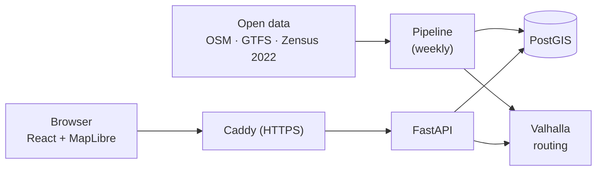

# reach — 15-Minute City Tübingen

`reach` measures how well residents of Tübingen can reach everyday services — supermarkets,
pharmacies, doctors, childcare, schools, parks, public transport — within 15 minutes on foot,
by bike or by wheelchair. It shows underserved areas on an interactive map and recommends
where new facilities would help the most people.

Course project for **DS500 Data Science Project** (M.Sc. Data Science in Business and Economics,
University of Tübingen, winter term 2026/27), Topic 9 "The 15-Minute City".

> **Status: start of implementation.** Architecture and team rules are defined; the Python
> workspace (`pipeline/`, `api/` skeletons with uv) exists, everything else is being built.
> Commands below marked *planned* become available step by step.

## What it does

- **Accessibility map** — 15-minute reachability per facility category and travel profile on the
  official Zensus 2022 100 m grid, aggregated to city districts.
- **Public transport supply** — scheduled weekday departures at stops within a 10-minute walk.
- **Pin-drop inspector** — click anywhere in the city: what is reachable, how long it takes, and
  which category is the weakest.
- **Recommendations** — candidate zones for new facilities, ranked by the number of residents who
  would gain 15-minute access.
- **Automated and validated** — a weekly pipeline downloads open data, validates it and publishes
  new results only if all checks pass.

## Architecture in one picture



Valhalla is the single routing engine for counting, isochrones and live queries. Everything runs
with Docker Compose on one small server. Details: [`docs/architecture.md`](docs/architecture.md).

## Repository layout

| Path | Content | Status |
|---|---|---|
| `docs/` | Architecture, methodology, features, glossary, notes, team decisions | ✅ |
| `AGENTS.md`, `CLAUDE.md` | Rules for coding agents | ✅ |
| `CONTRIBUTING.md` | Branches, commits, pull requests, releases | ✅ |
| `CHANGELOG.md` | Change history | ✅ |
| `pipeline/` | Data pipeline (Python, uv workspace member) | skeleton |
| `api/` | FastAPI backend (Python, uv workspace member) | skeleton |
| `web/` | React + MapLibre frontend | planned |
| `config/` | Study area, profiles, categories, thresholds, Valhalla limits | planned |
| `infra/` | Dockerfiles, Caddy, database roles, scheduler, server setup | planned |

## Getting started

Requirements: [uv](https://docs.astral.sh/uv/), Docker (Desktop) with Compose, Node.js for the
frontend. Without uv: `pip install -r requirements.txt` (exported from `uv.lock`).

```bash
git clone https://github.com/IsochroneLabs/reach.git
cd reach
git switch dev

uv sync                 # Python 3.12 environment (.venv) for pipeline and api
uv run pytest           # tests
uv run ruff check .     # lint
make up                 # planned: start PostGIS, Valhalla, API, Caddy locally
make pipeline           # planned: download data, compute and publish results
```

## Data sources

| Source | Used for | Licence |
|---|---|---|
| [Geofabrik](https://download.geofabrik.de/europe/germany/baden-wuerttemberg/tuebingen-regbez.html) OpenStreetMap extract | Street network, facilities, boundaries, land use | ODbL 1.0 |
| [NVBW](https://www.nvbw.de/open-data/fahrplandaten) GTFS (naldo) | Public transport stops and departures | dl-de/by-2-0, ODbL |
| [Destatis Zensus 2022](https://www.zensus2022.de/) 100 m grid | Residents per cell | dl-de/by-2-0 |
| Elevation tiles via Valhalla | Slopes (per-profile setting) | per source |

© OpenStreetMap contributors · © Statistisches Bundesamt (Destatis) · NVBW.

## Documentation

| Document | Content |
|---|---|
| [`docs/architecture.md`](docs/architecture.md) | **Binding** system description, decisions and change log |
| [`docs/methodology.md`](docs/methodology.md) | **Binding** categories, thresholds, scoring, recommender, validation experiments |
| [`docs/features.md`](docs/features.md) | Features, priorities and roadmap |
| [`docs/glossary.md`](docs/glossary.md) | Project vocabulary |
| [`docs/notes.md`](docs/notes.md) | Open points and future work |
| [`docs/prompts/implementation.md`](docs/prompts/implementation.md) | Prompts for building the system with a coding agent, phase by phase |
| [`docs/project_management_decisions.md`](docs/project_management_decisions.md) | Team and course organisation |
| [`CONTRIBUTING.md`](CONTRIBUTING.md) | How we work together |
| [`AGENTS.md`](AGENTS.md) | Rules for coding agents |

## Team

| Name | GitHub |
|---|---|
| Rico | [RicoS03](https://github.com/RicoS03) |
| Socke | [konstantinholl](https://github.com/konstantinholl) |
| Juju | [nicholas-tuebi](https://github.com/nicholas-tuebi) |

## Milestones

| Date | Milestone |
|---|---|
| 25 Nov 2026 | Interim presentation (`v0.1.0`) |
| 22 Jan 2027, 23:59 | Submission: code, documentation, video (`v1.0.0`) |
| 29 Jan 2027 | Final presentation |
