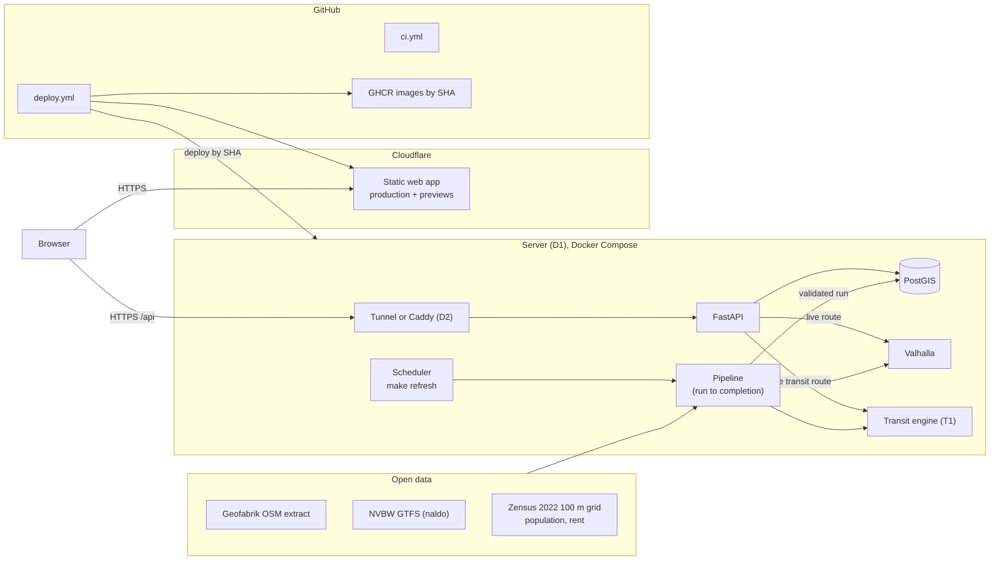

# Architecture — reach

> **Status:** v1.1-draft (22 Nov 2026). Target architecture of the rebuild. Every change bumps the
> version and adds a line to the [Change log](#change-log). Decisions are listed in
> [Section 13](#13-decisions); items marked **[OPEN]** are settled before the related code is
> written. What is computed (destinations, travel times, fit, validation) is defined in
> [`methodology.md`](methodology.md); the user and use cases in [`product.md`](product.md).

## 1. Goal

reach helps students who are new to Tübingen decide where to live, by showing how long their own
everyday trips take from each part of the city on foot, by bike (with hills) and by bus, and
explaining the differences in plain language.

A scheduled pipeline on a small server downloads open data, validates it, computes raw travel
times from every relevant 100 m cell to the destinations students care about (walk and bike with
Valhalla, transit with a transit engine) for several trip windows, and publishes them to PostGIS.
An API computes the personal fit and the reasons at request time; a static web app on Cloudflare
shows them. A release PR into `main` deploys everything automatically.

## 2. Principles

1. **Raw times in batch, personal answers at request time.** The pipeline stores travel times
   only; the fit depends on the student profile and is computed by the API (< 500 ms for the
   city). Changing fit parameters never needs re-routing.
2. **Network routing, not polygons.** Times come from routing engines (matrix or journey
   planning); isochrones are display only (archive V1: polygons over-count by 18–20 %).
3. **One data snapshot per run.** Every run uses one OSM extract, one GTFS feed and one Zensus
   file, recorded with dates and checksums under a `run_id`.
4. **Native census grid.** The unit is the Zensus 2022 100 m cell; no re-gridding.
5. **A failed run never breaks the app.** New results become visible only after validation passes.
6. **Nothing personal on the server.** No accounts, no stored profiles, no request-body logging,
   no tracking.
7. **Everything as code, nobody deploys by hand.** Images, Compose files, engine configs,
   workflows and the server runbook live in the repository.

## 3. System overview



| Component | Runs | Responsibility |
|---|---|---|
| Web app | Cloudflare (static) | Onboarding, map, place check, comparison; profile in the browser |
| Tunnel or Caddy | always (D2) | Public HTTPS entry to the API; no other port is reachable |
| FastAPI | always | Reference data, address search, fit, cell detail, live routes |
| PostGIS | always | Published runs, addresses, provenance, validation reports |
| Valhalla | always | Walk and bike: matrix (pipeline), route (live) |
| Transit engine | per T1 | Transit (and bike + transit) travel times; live transit route for U2 |
| Pipeline | on schedule / on demand | acquire → … → publish → cleanup |

## 4. Data sources

| Source | Provides | Refresh | Licence |
|---|---|---|---|
| Geofabrik `tuebingen-regbez-latest.osm.pbf`, clipped with `osmium` to the routing area | Network for Valhalla, destinations, addresses, districts | weekly | ODbL 1.0 |
| NVBW GTFS naldo ("mit Liniennetz") | Stops, trips, timetables for the trip windows | weekly; validity checked | dl-de/by-2-0, ODbL |
| Zensus 2022 population, 100 m grid | Populated cells (origins) | static (15 May 2022) | dl-de/by-2-0 |
| Zensus 2022 average net cold rent per m², 100 m grid | Optional rent per cell (rented flats in residential buildings, no student halls; uncertain values in brackets, suppressed cells missing) | static | dl-de/by-2-0 |
| Elevation tiles (`valhalla_build_elevation`) | Grades on every edge | once, cached | per source |
| `config/campus.yaml` | Campus sites per programme | manual, reviewed by the team | – |

Known limits (shown in the app and in `validation.md`): census values of small cells are
perturbed; the census counts main residences in May 2022; OSM completeness varies per
destination type; the timetable is a schedule, not real-time.

## 5. Spatial model

### 5.1 CRS

| Where | CRS |
|---|---|
| Storage and computation | EPSG:25832 (ETRS89 / UTM 32N) |
| Census cell id | EPSG:3035 grid id (`CRS3035RES100mN…E…`) as key |
| API output, frontend | EPSG:4326, transformed with `ST_Transform` at query time |

### 5.2 Study area and routing area

- **City boundary:** OSM `admin_level` 8, AGS `08416041`.
- **Routing area:** city boundary + 4 km buffer; network, destinations and stops are clipped to
  it, so trips can end outside the city (e.g. a climbing gym in a neighbouring town).

### 5.3 Origins (A1)

- **Populated cells:** Zensus cells with residents whose centroid lies inside the city boundary
  (archive run: 1,699 cells, 99.9 % of residents).
- **Address cells:** cells without residents but with an OSM residential address inside the city
  (new buildings since 2022, U2). They are routed like populated cells but never ranked.
- **Origin point:** the cell centroid (archive V6: a building-based origin changes ~2 % of results,
  in both directions; the centroid is robust).

### 5.4 Areas (A2)

Computation per cell. Ranking and reasons per **area**: the 23 core-town districts (OSM admin
level 11) and 8 Teilorte (level 9); level 10 overlaps level 11 and is not used. The map colours
the cells inside an area; U2 always shows the user's own cell.

## 6. Routing

### 6.1 Routing profiles

| Mode | Engine | Settings | Status |
|---|---|---|---|
| `walk` | Valhalla `pedestrian` | `walking_speed` 5.0 km/h (flat ground); grade factor from elevation | settled (O2) |
| `bike` | Valhalla `bicycle` | `bicycle_type` Hybrid, `cycling_speed` 15 km/h, `use_hills` default | settled (O2) |
| `transit` | transit engine (T1) | walk 5.0 km/h to/from stops, wait, ride, transfers; per trip window | [OPEN] T1 |
| `bike_transit` | transit engine (T1), if supported | bike to a stop, park, ride (no bike on board), walk | optional, first cut |

Elevation is built into the Valhalla tiles; Valhalla applies the grades to walking and cycling
(archive notes N5: Marktplatz → Schloss 681 s up vs. 537 s flat at 3.39 km/h; Hauptbahnhof →
Waldhäuser-Ost by bike 1,196 s up vs. 865 s down). This is what makes "Tübingen is hilly" visible.

### 6.2 Trip windows (A3)

A trip window = weekday + reference date + time + direction, defined in `config/config.yaml`
(draft list there: weekday morning arrival for lectures, midday, evening, Fri/Sat night return,
Saturday to the main station). The reference date is chosen per window inside the GTFS validity
(no public or school holiday, services active); GTFS times beyond 24:00 belong to the service day
before. Walk and bike do not depend on the window; transit does.

### 6.3 What the pipeline computes

For every origin cell, destination type and mode: the travel time to the **nearest k**
destinations of the type (all campus sites always), per trip window for transit. Walk and bike
use Valhalla matrices in cell blocks with a straight-line prefilter; transit uses the engine of
T1. Transit results also keep their legs (access walk, wait, ride, transfers, egress) and the
departures per hour at the first stop, for reasons and "reliability".

### 6.4 Using Valhalla efficiently (carried over from the archive)

1. Matrices in spatial blocks of cells, all destination types per request; targets prefiltered
   by straight-line reach (speed × factor × cap + margin).
2. `costmatrix` for every matrix (`config/valhalla.json`); `timedistancematrix` misses routes
   (archive N8).
3. Async client with bounded concurrency; retries on timeouts and 5xx.
4. Tiles packed in one `valhalla_tiles.tar`; the config Valhalla runs with is copied at start and
   checked by the pipeline (archive N9).
5. Valhalla grows by ~0.5–1.4 GB per worker thread during large matrices and keeps it (archive
   N4); the refresh restarts it after the travel-time stage or limits threads (A4).
6. Valhalla listens only on the internal Docker network.

## 7. Pipeline

One Python package, one entry point, idempotent stages with manifests.

| Stage | Output | Notes |
|---|---|---|
| `acquire` | raw files + provenance | skips unchanged downloads, retries with backoff |
| `validate` | cleaned layers (GeoParquet, EPSG:25832): cells, districts, destinations, campus sites, addresses, stops; report part 1 | fails on schema, coverage, completeness or GTFS window errors |
| `tiles` | `valhalla_tiles.tar` with elevation | built by the one-shot `valhalla-build` from `make refresh`, only if the OSM snapshot changed (O5) |
| transit build | engine graph/network | per T1, inside `make refresh` |
| `travel_times` | raw times cell × destination × mode × trip window (+ transit legs, departures) | batched, runtime and peak memory logged |
| `validate_results` | report part 2 (plausibility, completeness, matrix vs. route) | any fail stops the run |
| `publish` | schema `run_<id>`, `current` switched atomically | only stage writing results |
| `cleanup` | – | keeps the last 3 published runs |

`make refresh` runs these steps **one after the other** on the host (A4); the pipeline container
has no Docker socket. Intermediate files live in `data/` (git-ignored).

## 8. Database

Schemas: `run_<id>` (one per published run), `current` (views on the latest published run; the
API reads only these), `meta` (`runs`, `data_sources`, `schema_migrations`). Roles: `app_read`
(API), `pipeline_write` (pipeline), `supervisor_read` (read-only for supervisors, **[VERIFY]**
whether the course requires it, A5). Tables: [`data_contract.md`](data_contract.md) (results
planned in S1.4).

## 9. API

FastAPI, read-only on `current`. Planned endpoints (S1.10): `GET /api/health` (incl. build SHA),
`GET /api/destination-types`, `GET /api/campus-sites`, `GET /api/addresses?q=`, `POST /api/fit`
(student profile → ranked areas and cells with reasons), `GET /api/cell/{id}` (all trips per mode
and window), live route incl. a transit leg (U2). Rules: CORS allowlist for the frontend origins
(D4); token-bucket rate limit per client IP; POST bodies are not logged; caches key only on the
weight vector of the profile; ETag per run.

## 10. Frontend

React + TypeScript + Vite + MapLibre GL JS, built to static files and deployed to Cloudflare
(previews for PRs and `dev`, production from `main`). API base URL from build-time config. The
student profile lives in the URL and `localStorage`. Basemap per D5 (no user data to third
parties). OSM, GTFS and Zensus attribution always visible.

## 11. Delivery

| Trigger | Workflow | What happens |
|---|---|---|
| PR into `dev` | `ci.yml` | lint, format, pytest, data-contract tests (disposable PostGIS), web lint/build, Playwright with API fixtures, Docker builds without push; frontend preview (same-repository PRs) |
| Push to `dev` | `ci.yml` | the same; frontend preview of `dev`, URL in the run summary |
| Push to `main` (merged release PR) | `deploy.yml` | CI on the merge commit → images to GHCR by SHA → frontend to Cloudflare → backend: pull by SHA, migrate, `docker compose -f compose.prod.yaml up -d` (volumes kept) → smoke test → on failure rollback of backend and frontend, failed run, team webhook → summary |
| `workflow_dispatch` | `deploy.yml` | redeploy or rollback of a given SHA; available once the workflow is on the default branch `dev` |

One GitHub environment `production` holds the deploy secrets; deploys never overlap; actions are
pinned to commit SHAs; least-privilege `permissions:`. Until the server exists, the backend job is
skipped with a warning. The data refresh is separate: a scheduled job on the server runs
`make refresh`; data never passes through GitHub or Cloudflare. Details:
[`deployment.md`](deployment.md).

## 12. Operations

| Topic | Choice |
|---|---|
| Server | per D1; Linux, Docker Engine + Compose, swap |
| Memory budget | 8 GB target, measured on first deploy **[VERIFY]**: PostGIS ≈ 0.5 GB, API ≈ 0.2 GB, Valhalla idle < 0.1 GB but 1.4–3 GB during large matrices (archive N4), transit engine per T1; the refresh runs heavy steps one after the other (A4) |
| Public access | per D2; PostGIS, Valhalla and the transit engine never reachable from outside |
| Scheduler | weekly `make refresh` (S3.1), `flock` against overlaps, failure webhook |
| Backups | nightly `pg_dump` to a volume; results are reproducible from the pipeline (S3.2) |
| Restarts | `restart: unless-stopped` and health checks on all services |

## 13. Decisions

### Settled (21 Nov 2026, carried over from the archive or given by the rebuild brief)

| ID | Decision | Origin |
|---|---|---|
| O1 | Zensus 2022 100 m cells as unit; cell centroid as origin | archive O5, V6 |
| O2 | Valhalla (official image, pinned) for walk and bike, tiles always with elevation, Valhalla's slope model kept; `costmatrix` for every matrix; walk 5.0 km/h, bike 15 km/h Hybrid | archive O3, O7, O15, N5, N8; brief (walk speed) |
| O3 | CRS rules of §5.1 | archive |
| O4 | Raw travel times stored; fit, rankings and reasons derived by the API at request time | brief; archive rule 5 |
| O5 | Tiles built by the one-shot `valhalla-build`, orchestrated by `make refresh` on the host; atomic swap; no Docker socket in the pipeline | archive O19 |
| O6 | Routing area = city boundary + 4 km | archive O13 |
| O7 | Run schemas + `current` views; only `publish` writes results; validation before the switch | archive |
| O8 | No public data APIs at runtime; addresses from the OSM extract in PostGIS | archive rule 8; brief |
| O9 | Failed runs and failed deploys notify a team webhook (URL as secret) | archive O10 |
| O10 | Python via uv, one workspace (`pipeline`, `api`), one lockfile | archive |
| O11 | Frontend as a Cloudflare Worker with static assets; previews for PRs and `dev`; static asset requests have no Cloudflare request or storage charge under current pricing | brief; product comparison and official pricing docs checked 22 Nov 2026 |
| O12 | Production only through release PR `dev` → `main` and `deploy.yml`; images on GHCR by SHA | brief |
| O13 | Origins = populated cells + address cells; ranking over populated cells only | A1 |
| O14 | Areas = districts (admin 11) and Teilorte (admin 9) for ranking and reasons; map per cell | A2 |
| O15 | Trip windows with weekday + reference date; GTFS times > 24:00; night window on Fri/Sat | A3 |
| O16 | Refresh runs heavy steps sequentially (assumption for T1 and the memory budget) | A4 |

### Open

| ID | Question | Options | Criteria | Step |
|---|---|---|---|---|
| T1 | Transit engine | (a) Valhalla multimodal (does `sources_to_targets` support it in 3.9.1 or newer?), (b) r5py / R5, (c) OpenTripPlanner, or a combination; fallback: departures at nearby stops, labelled approximate | cell × destination matrix, trip-window handling (arrival time, night), runtime and peak memory for Tübingen, Docker/CI fit, image size, licence, bike as access mode, fit in 8 GB under A4 | S1.1 |
| D1 | Server | bwCloud vs. Hetzner | RAM, cost within 20 € in total, public IP/ports, how GitHub Actions reach it | S1.2 |
| D2 | Backend access and deploy | Cloudflare Tunnel (no inbound ports) vs. Caddy on 443 + SSH deploy | security, effort, needs a domain on Cloudflare (tunnel) | S1.2 |
| D3 | Domain | cheap own domain on Cloudflare vs. free hostnames (`*.workers.dev`, `sslip.io`) with CORS | cost, D2 dependency, CORS | S1.2 |
| D4 | Frontend–API wiring | API base URL per environment; where previews get data (production API read-only vs. fixtures) | privacy, stability, CORS | S1.2 |
| D5 | Basemap | e.g. self-hosted vector tiles vs. a free tile host | no user data to third parties, cost, size | S2.1 |

## 14. Repository layout (target)

```
reach/
├── AGENTS.md, CLAUDE.md, README.md, CONTRIBUTING.md, CHANGELOG.md
├── pyproject.toml, uv.lock, .python-version   # uv workspace (pipeline, api)
├── Makefile                                   # up, down, pipeline, refresh, migrate, test, lint
├── compose.yaml, compose.prod.yaml            # local / production
├── .env.example
├── config/            # config.yaml, campus.yaml, personas.yaml, valhalla.json, test_clip.yaml
├── pipeline/          # reach_pipeline
├── api/               # reach_api
├── web/               # React + MapLibre app (npm)
├── infra/             # Dockerfiles, db roles/migrations, server files
├── tests/integration/ # end-to-end on the test clip
├── docs/
└── .github/           # workflows, CODEOWNERS, PR template
```

## Change log

| Version | Date | Change | Why |
|---|---|---|---|
| v1.1-draft | 2026-11-22 | Settled O11 on Cloudflare Workers static assets and recorded current static asset billing; updated the free-hostname option to `workers.dev` | The frontend is a static Vite SPA; no edge compute is needed for the current deployment |
| v1.0-draft | 2026-11-21 | New architecture for the student rebuild: raw travel times per cell × destination × mode × trip window, fit at request time, Cloudflare frontend, release-driven deploy; carried-over decisions renumbered O1–O16 with origin; T1 and D1–D5 open | Rebuild brief of 21 Nov 2026; plan S0.2 |
