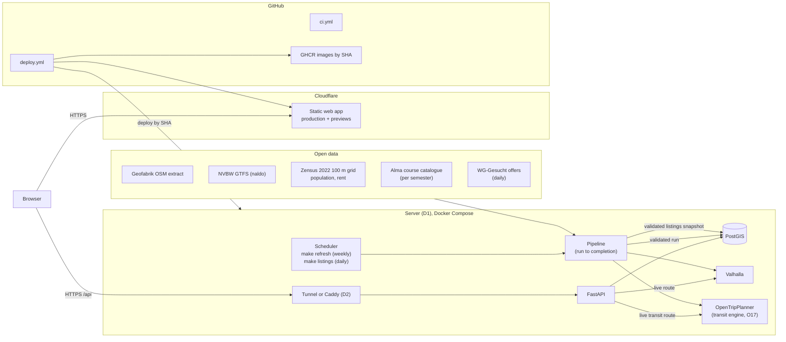

# Architecture — reach

> **Status:** v1.4-draft (26 Nov 2026). Target architecture of the rebuild. Every change bumps the
> version and adds a line to the [Change log](#change-log). Decisions are listed in
> [Section 13](#13-decisions); items marked **[OPEN]** are settled before the related code is
> written. What is computed (destinations, travel times, fit, validation) is defined in
> [`methodology.md`](methodology.md); the user and use cases in [`product.md`](product.md).

## 1. Goal

reach helps students who are new to Tübingen decide where to live, by showing how long their own
everyday trips take from each part of the city on foot, by bike (with hills) and by bus, and
explaining the differences in plain language.

A scheduled pipeline on a small server downloads open data, validates it, computes raw travel
times from every relevant 100 m cell to the destinations students care about (walk and bike with
Valhalla, transit with OpenTripPlanner) for several trip windows, and publishes them to PostGIS.
An API computes the personal fit and the reasons at request time; a static web app on Cloudflare
shows them. A release PR into `main` deploys everything automatically.

Two smaller inputs complete the picture (decided 26 Nov 2026, O22–O27): once per semester the
pipeline reads the compulsory courses of every programme from the university's public course
catalogue (Alma) and maps them to buildings and campus sites; and once a day a separate listings
job fetches the current WG-Gesucht offers for Tübingen, geocodes them, routes them to the same
destinations and publishes them next to the run, so the app can show and compare real listings.

## 2. Principles

1. **Raw times in batch, personal answers at request time.** The pipeline stores travel times
   only; the fit depends on the student profile and is computed by the API (< 500 ms for the
   city). Changing fit parameters never needs re-routing.
2. **Network routing, not polygons.** Times come from routing engines (matrix or journey
   planning); isochrones are display only (archive V1: polygons over-count by 18–20 %).
3. **One data snapshot per run.** Every run uses one OSM extract, one GTFS feed and one Zensus
   file, recorded with dates and checksums under a `run_id`.
4. **Native census grid.** The unit is the Zensus 2022 100 m cell; no re-gridding.
5. **A failed run never breaks the app.** New results become visible only after validation passes.
6. **Nothing personal on the server.** No accounts, no stored profiles, no request-body logging,
   no tracking.
7. **Everything as code, nobody deploys by hand.** Images, Compose files, engine configs,
   workflows and the server runbook live in the repository.

## 3. System overview



| Component | Runs | Responsibility |
|---|---|---|
| Web app | Cloudflare (static) | *Find* map, *Check* (places and listings), comparison, application text; profile in the browser |
| Tunnel or Caddy | always (D2) | Public HTTPS entry to the API; no other port is reachable |
| FastAPI | always | Reference data, address search, fit, cell detail, live routes |
| PostGIS | always | Published runs, addresses, provenance, validation reports |
| Valhalla | always | Walk and bike: matrix (pipeline), route (live) |
| OpenTripPlanner (transit engine) | always (O17); restarted after `travel_times` | Transit and bike + transit: per-pair trips in the pipeline, live transit route for *Check* |
| Pipeline | on schedule / on demand | `make refresh`: acquire → … → publish → cleanup (weekly); `make listings`: listing crawl → validate → route → `publish_listings` (daily, O24) |

## 4. Data sources

| Source | Provides | Refresh | Licence |
|---|---|---|---|
| Geofabrik `tuebingen-regbez-latest.osm.pbf`, clipped with `osmium` to the routing area | Network for Valhalla, destinations, addresses, districts | weekly | ODbL 1.0 |
| NVBW GTFS naldo ("mit Liniennetz") | Stops, trips, timetables for the trip windows | weekly; validity checked | dl-de/by-2-0, ODbL |
| Zensus 2022 population, 100 m grid | Populated cells (origins) | static (15 May 2022) | dl-de/by-2-0 |
| Zensus 2022 average net cold rent per m², 100 m grid | Optional rent per cell (rented flats in residential buildings, no student halls; uncertain values in brackets, suppressed cells missing) | static | dl-de/by-2-0 |
| Elevation tiles (`valhalla_build_elevation`) | Grades on every edge | once, cached | per source |
| Alma (HISinOne), public course catalogue of the University of Tübingen | Programmes (degree, name), compulsory modules with recommended semester, course sessions (weekday, time, room, building), building addresses (O23) | once per semester, reused while unchanged | university terms of use **[VERIFY]** (F3.1); reachability from the server **[VERIFY]** (notes N21) |
| `config/campus.yaml` | Campus sites, Mensa list, default campus mix; **manual overrides** that win over Alma; fallback programme → site table while Alma is not available | manual, reviewed by the team | – |
| WG-Gesucht, public offers for Tübingen (WG rooms, studios, flats) | Listings: parameters, address as published, image URLs, short description (O24) | daily (listings job) | WG-Gesucht AGB; permission requested from SMP GmbH & Co. KG **[VERIFY]** (notes N20); data minimised, images linked, never copied |

Known limits (shown in the app and in `validation.md`): census values of small cells are
perturbed; the census counts main residences in May 2022; OSM completeness varies per
destination type and label; the timetable is a schedule, not real-time; Alma lists rooms per
semester and may change during it; listings are as published by their authors (addresses often
without house number) and up to one day old.

## 5. Spatial model

### 5.1 CRS

| Where | CRS |
|---|---|
| Storage and computation | EPSG:25832 (ETRS89 / UTM 32N) |
| Census cell id | EPSG:3035 grid id (`CRS3035RES100mN…E…`) as key |
| API output, frontend | EPSG:4326, transformed with `ST_Transform` at query time |

### 5.2 Study area and routing area

- **City boundary:** OSM `admin_level` 8, AGS `08416041`.
- **Routing area:** city boundary + 4 km buffer; network, destinations and stops are clipped to
  it, so trips can end outside the city (e.g. a climbing gym in a neighbouring town).

### 5.3 Origins (A1)

- **Populated cells:** Zensus cells with residents whose centroid lies inside the city boundary
  (archive run: 1,699 cells, 99.9 % of residents).
- **Address cells:** cells without residents but with an OSM residential address inside the city
  (new buildings since 2022, *Check*). They are routed like populated cells but never ranked.
- **Origin point:** the cell centroid (archive V6: a building-based origin changes ~2 % of results,
  in both directions; the centroid is robust).
- **Listing points** (O24, O25): geocoded listing addresses. They are routed as points of their
  own, never ranked and never part of a cell's value. Geocode precision decides what is shown
  (methodology §8.1).

### 5.4 Areas (A2)

Computation per cell. Ranking and reasons per **area**: the 23 core-town districts (OSM admin
level 11) and 8 Teilorte (level 9); level 10 overlaps level 11 and is not used. The map colours
the cells inside an area; *Check* always shows the user's own cell.

## 6. Routing

### 6.1 Routing profiles

| Mode | Engine | Settings | Status |
|---|---|---|---|
| `walk` | Valhalla `pedestrian` | `walking_speed` 5.0 km/h (flat ground); grade factor from elevation | settled (O2) |
| `bike` | Valhalla `bicycle` | `bicycle_type` Hybrid, `cycling_speed` 15 km/h, `use_hills` default | settled (O2) |
| `transit` | OpenTripPlanner `planConnection` | walk 5.0 km/h to/from stops, wait, ride, transfers; per trip window (`latestArrival` for arrive-by windows) | settled (O17) |
| `bike_transit` | OpenTripPlanner, access mode `BICYCLE_PARKING` | bike to a stop, park, ride (no bike on board), walk; no elevation in the OTP graph (access legs are short) | settled (O17); optional, first cut |

Elevation is built into the Valhalla tiles; Valhalla applies the grades to walking and cycling
(archive notes N5: Marktplatz → Schloss 681 s up vs. 537 s flat at 3.39 km/h; Hauptbahnhof →
Waldhäuser-Ost by bike 1,196 s up vs. 865 s down). This is what makes "Tübingen is hilly" visible.

### 6.2 Trip windows (A3)

A trip window = weekday + reference date + time + direction, defined in `config/config.yaml`
(draft list there: weekday morning arrival for lectures, midday, evening, Fri/Sat night return,
Saturday to the main station). The reference date is chosen per window inside the GTFS validity
(no public or school holiday, services active); GTFS times beyond 24:00 belong to the service day
before. Walk and bike do not depend on the window; transit does.

### 6.3 What the pipeline computes

For every origin cell, destination type and mode: the travel time to the **nearest k**
destinations of the type **and** to the nearest *k_label* destinations of every destination label
of the type (O22; brands for `grocery`, categories for `sport` and `hobby`), deduplicated; all
campus sites used by any programme always (O23); per trip window for transit. Walk and bike
use Valhalla matrices in cell blocks with a straight-line prefilter. Transit has no matrix API
(OTP 2 is a journey planner): the stage sends one OTP query per cell × destination pair and trip
window, with candidates prefiltered by straight line (the `2k` nearest per type) and bounded
concurrency (spike: 4 threads, 193,897 pairs for the city in 25 min). Transit results also keep
their legs (access walk, wait, ride, transfers, egress, first stop and route, departure) and the
departures per hour at the first stop (from GTFS, not from the engine), for reasons and
"reliability". The time definition per window is methodology §4 (M6).

### 6.4 Using Valhalla efficiently (carried over from the archive)

1. Matrices in spatial blocks of cells, all destination types per request; targets prefiltered
   by straight-line reach (speed × factor × cap + margin).
2. `costmatrix` for every matrix (`config/valhalla.json`); `timedistancematrix` misses routes
   (archive N8).
3. Async client with bounded concurrency; retries on timeouts and 5xx.
4. Tiles packed in one `valhalla_tiles.tar`; the config Valhalla runs with is copied at start and
   checked by the pipeline (archive N9).
5. Valhalla grows by ~0.5–1.4 GB per worker thread during large matrices and keeps it (archive
   N4); the refresh restarts it after the travel-time stage or limits threads (A4).
6. Valhalla listens only on the internal Docker network.

### 6.5 Point routing for listings and *Check* (O25)

A listing or a checked place is one point. It is routed with the same code and the same target
rule as a cell (nearest k per type and per label, all campus sites): walk and bike as one Valhalla
`costmatrix` request (one source, many targets), transit as OTP queries per trip window with
bounded concurrency. The daily listings job routes every new or moved listing; the API answers
`POST /api/place` live for a single point (target < 2 s on the server). Point results are not
cached (caches key only on the weight vector, principle 6). Listing times are stored with the
`run_id` whose destinations they were routed against; after a newer run is published, the next
listings job re-routes, and until then the API falls back to live point routing.

## 7. Pipeline

One Python package, one entry point, idempotent stages with manifests.

| Stage | Output | Notes |
|---|---|---|
| `acquire` | raw files + provenance | skips unchanged downloads, retries with backoff; source `alma` fetched once per semester (rate-limited crawl) and reused while the semester is unchanged (O23) |
| `validate` | cleaned layers (GeoParquet, EPSG:25832): cells, districts, destinations **with labels** (O22), campus sites, campus buildings, programmes and programme sites (O23), addresses, stops; report part 1 | fails on schema, coverage, completeness (incl. every offered label, V10; building match rate, V9) or GTFS window errors |
| `tiles` | `valhalla_tiles.tar` with elevation | built by the one-shot `valhalla-build` from `make refresh`, only if the OSM snapshot changed (O5) |
| transit build | OTP graph (`graph.obj`) from the clipped OSM extract and the GTFS feed clipped to the routing area | one-shot `--build --save` inside `make refresh`, after `tiles` (O17) |
| `travel_times` | raw times cell × destination × mode × trip window (+ transit legs, departures) | batched, runtime and peak memory logged |
| `validate_results` | report part 2 (plausibility, completeness, matrix vs. route) | any fail stops the run |
| `publish` | schema `run_<id>`, `current` switched atomically | only stage writing results |
| `cleanup` | – | keeps the last 3 published runs |

`make refresh` runs these steps **one after the other** on the host (A4); the pipeline container
has no Docker socket. Intermediate files live in `data/` (git-ignored).

**Listings job** (`make listings`, daily, O24). Small and separate from the refresh; both take the
same `flock`, so they never run at the same time (O16):

| Step | Output | Notes |
|---|---|---|
| `listings_acquire` | raw search and detail pages + provenance | Tübingen search pages from config; detail pages only for new or changed listing ids; polite rate limit; stops and notifies on captcha or unexpected page structure, never bypasses bot protection |
| `listings_validate` | listings (GeoParquet, EPSG:25832) with geocode precision; report (V12) | parse with one field spec; contact data stripped, no names stored; geocoding against `current.addresses` (house → street → district) |
| `listings_travel_times` | raw times listing × destination × mode × trip window | point routing of §6.5 for new, moved or re-routed listings only |
| `publish_listings` | schema `lst_<id>`, `listings` views switched atomically | the second and only other writer of results (exception to O7, O24); keeps the last 3 snapshots; listings missing from the source for N days (config) are dropped |

## 8. Database

Schemas: `run_<id>` (one per published run), `current` (views on the latest published run; the
API reads only these), `lst_<id>` (one per published listings snapshot) and `listings` (views on
the latest snapshot; the API reads these for listings), `meta` (`runs`, `data_sources`,
`schema_migrations`; listing snapshots are recorded in `meta.runs` with their own kind). Roles: `app_read`
(API), `pipeline_write` (pipeline), `supervisor_read` (read-only for supervisors, **[VERIFY]**
whether the course requires it, A5). Tables: [`data_contract.md`](data_contract.md) (results
planned in S1.4; labels, programmes and listings planned in F2.4, F3.4 and F4.1 of
[`extension_plan.md`](extension_plan.md)).

## 9. API

FastAPI, read-only on `current` and `listings`. Planned endpoints (S1.10): `GET /api/health`
(incl. build SHA), `GET /api/destination-types` (with labels and counts, O22),
`GET /api/campus-sites`, `GET /api/addresses?q=`, `POST /api/fit` (student profile incl.
programme, degree, semester and chosen labels → ranked areas and cells with reasons),
`GET /api/cell/{id}` (all trips per mode and window), live route incl. a transit leg (*Check*).
Added by the extensions (O23–O25): `GET /api/programmes` (search, degree filter),
`GET /api/programmes/{id}?semester=` (sites, buildings, weekly hours), `POST /api/place` (one point
→ raw times, live, no cache), `GET /api/listings` (filters), `GET /api/listings/{id}` (detail and
raw times), `POST /api/listings/fit` (profile → fit per listing). Rules: CORS allowlist for the
frontend origins (D4); token-bucket rate limit per client IP; POST bodies are not logged; caches
key only on the weight vector of the profile; ETag per run and per listings snapshot; listing
images are returned as links, never proxied or stored.

## 10. Frontend

React + TypeScript + Vite + MapLibre GL JS, built to static files and deployed to Cloudflare
(previews for PRs and `dev`, production from `main`). API base URL from build-time config. The
student profile lives in the URL and `localStorage`. Basemap per D5 (no user data to third
parties). OSM, GTFS and Zensus attribution always visible; listings name and link their source.

- **Design (O27):** design direction *Atelier*, binding in `docs/design.md` (*planned, F1.1*):
  white space, typography as the main graphic element, hairlines instead of shadows, radius 0, one
  ink colour plus greys, monochrome map ramp, explicit rules against generic UI patterns. Fonts are
  OFL-licensed and self-hosted on our own origin (no third-party font host).
- **Listing images** load from the listing source's own image host in the student's browser,
  only when the student opens a listing (not on the map or in the list), and the about page says
  so; reach never copies them.
- **Application text (O26):** generated in the browser from templates (profile + listing + a few
  personal lines in `localStorage`); nothing is sent to the server.

## 11. Delivery

| Trigger | Workflow | What happens |
|---|---|---|
| PR into `dev` | `ci.yml` | lint, format, pytest, data-contract tests (disposable PostGIS), web lint/build, Playwright with API fixtures, Docker builds without push; frontend preview (same-repository PRs) |
| Push to `dev` | `ci.yml` | the same; frontend preview of `dev`, URL in the run summary |
| Push to `main` (merged release PR) | `deploy.yml` | CI on the merge commit → images to GHCR by SHA → frontend to Cloudflare → backend: pull by SHA, migrate, `docker compose -f compose.prod.yaml up -d` (volumes kept) → smoke test → on failure rollback of backend and frontend, failed run, team webhook → summary |
| `workflow_dispatch` | `deploy.yml` | redeploy or rollback of a given SHA; available once the workflow is on the default branch `dev` |

One GitHub environment `production` holds the deploy secrets; deploys never overlap; actions are
pinned to commit SHAs; least-privilege `permissions:`. Until the server exists, the backend job is
skipped with a warning. The data refresh is separate: a scheduled job on the server runs
`make refresh`; data never passes through GitHub or Cloudflare. Details:
[`deployment.md`](deployment.md).

## 12. Operations

| Topic | Choice |
|---|---|
| Server | per D1; Linux, Docker Engine + Compose, swap |
| Memory budget | 8 GB target, measured on first deploy **[VERIFY]**: PostGIS ≈ 0.5 GB, API ≈ 0.2 GB, Valhalla idle < 0.1 GB but 1.4–3 GB during large matrices (archive N4), OTP ≈ 0.9 GB graph build, ≈ 1.35 GB during `travel_times`, ≈ 0.6 GB idle after the restart (spike, PR #79); `validate` up to ≈ 3.8 GB during the OSM clip (notes N11); the refresh runs heavy steps one after the other (A4) |
| Public access | per D2; PostGIS, Valhalla and the transit engine never reachable from outside |
| Scheduler | weekly `make refresh` (S3.1) and daily `make listings` (time from config, F4.9), one shared `flock` against overlaps, failure webhook; Alma once per semester inside the refresh |
| Listings job budget | small: a few hundred listings, only new or moved ones routed; runtime and peak memory measured on the server **[VERIFY]**; must finish well inside the gap between two refreshes |
| Backups | nightly `pg_dump` to a volume; results are reproducible from the pipeline (S3.2) |
| Restarts | `restart: unless-stopped` and health checks on all services |

## 13. Decisions

### Settled (21 Nov 2026, carried over from the archive or given by the rebuild brief)

| ID | Decision | Origin |
|---|---|---|
| O1 | Zensus 2022 100 m cells as unit; cell centroid as origin | archive O5, V6 |
| O2 | Valhalla (official image, pinned) for walk and bike, tiles always with elevation, Valhalla's slope model kept; `costmatrix` for every matrix; walk 5.0 km/h, bike 15 km/h Hybrid | archive O3, O7, O15, N5, N8; brief (walk speed) |
| O3 | CRS rules of §5.1 | archive |
| O4 | Raw travel times stored; fit, rankings and reasons derived by the API at request time | brief; archive rule 5 |
| O5 | Tiles built by the one-shot `valhalla-build`, orchestrated by `make refresh` on the host; atomic swap; no Docker socket in the pipeline | archive O19 |
| O6 | Routing area = city boundary + 4 km | archive O13 |
| O7 | Run schemas + `current` views; only `publish` writes results; validation before the switch | archive |
| O8 | No public data APIs at runtime; addresses from the OSM extract in PostGIS | archive rule 8; brief |
| O9 | Failed runs and failed deploys notify a team webhook (URL as secret) | archive O10 |
| O10 | Python via uv, one workspace (`pipeline`, `api`), one lockfile | archive |
| O11 | Frontend as a Cloudflare Worker with static assets; previews for PRs and `dev`; static asset requests have no Cloudflare request or storage charge under current pricing | brief; product comparison and official pricing docs checked 22 Nov 2026 |
| O12 | Production only through release PR `dev` → `main` and `deploy.yml`; images on GHCR by SHA | brief |
| O13 | Origins = populated cells + address cells; ranking over populated cells only | A1 |
| O14 | Areas = districts (admin 11) and Teilorte (admin 9) for ranking and reasons; map per cell | A2 |
| O15 | Trip windows with weekday + reference date; GTFS times > 24:00; night window on Fri/Sat | A3 |
| O16 | Refresh runs heavy steps sequentially (assumption for T1 and the memory budget) | A4 |
| O17 | **Transit engine = OpenTripPlanner 2.10** (official image `opentripplanner/opentripplanner`, pinned by digest, LGPL-3.0, run unmodified) for `transit` and `bike_transit`; Valhalla stays for `walk` and `bike`. Pipeline: graph build after `tiles`, then one query per pair and window with bounded concurrency; API: live transit route from the same service, internal network only. Valhalla multimodal is out (no multimodal `sources_to_targets`, no arrive-by); r5py is out (no trips after midnight, no arrive-by, no server for the live route). Fallback if OTP fails on the server: departures at nearby stops from GTFS, labelled approximate | T1 spike, PR #79 (report on the branch `exp/juju-transit-engine`, not merged by design), decided 23 Nov 2026 |

### Settled (26 Nov 2026, extensions after the interim presentation)

O18–O21 are reserved for D1–D4 as proposed on the Juju docs stack (PRs #83–#86, not yet in `dev`).

| ID | Decision | Origin |
|---|---|---|
| O22 | **Destination labels.** A destination type can have labels: the brand and a group for `grocery` (brand normalised from `brand:wikidata`, `brand`, `name`; group from tags, brand and name patterns: organic, package-free, international, discounter, full-range, village and farm shop, other), categories for the new types `sport` and `hobby` (from `sport=*` and hobby tags), the religion for `place_of_worship`. A destination can carry several labels; features of one label within 75 m or one sports centre are one destination. Travel times are stored for the nearest k per type and the nearest *k_label* per label (both from config) | QF3 (i), QF4 (i), extension plan F2 |
| O23 | **Programmes from Alma.** New source `alma`, read by `acquire` once per semester from the public course catalogue (rate-limited, generic user agent, raw pages kept as provenance); `validate` maps compulsory course sessions → rooms → buildings → OSM addresses → campus sites and computes the weekly hours per programme × degree × semester × site. `config/campus.yaml` holds manual overrides that win, and stays the fallback while Alma is unavailable | QF5 (ii) with degree choice, extension plan F3 |
| O24 | **Listings from WG-Gesucht, crawled daily on the server** by a separate listings job (`make listings`) with its own snapshot schemas `lst_<id>`, the views `listings` and the writer `publish_listings` (the only exception to O7). Data minimisation: no names or contact data, description shortened and stripped of contact data, images as links only, rows dropped N days after they leave the source. Polite crawling (rate limit from config, only new or changed detail pages), stop and notify on captcha or structure change, no bypassing of bot protection. Permission from SMP GmbH & Co. KG requested; the crawl can be switched off in config (`listings.enabled`) without affecting the rest of the app | QF1 (A), decided by Juju 26 Nov 2026; legal risk recorded in notes N20 |
| O25 | **Point routing** for listings and *Check*: same targets and engines as cells (§6.5); listings routed in the daily job, single points live via `POST /api/place`; no caching of point results; listing times tied to the `run_id` they were routed against | extension plan F4.5 |
| O26 | **Application text** from templates in the browser (DE/EN, three tones; profile, listing and personal lines kept in `localStorage`); nothing sent to the server. An LLM-generated variant is **planned**, not decided: it needs its own yes (provider, key as a secret, cost, privacy review, explicit opt-in) | QF2 (a) now, (b) as a plan |
| O27 | **Frontend design direction *Atelier*** (light, editorial, minimal), binding through `docs/design.md`; self-hosted OFL fonts | QF6, extension plan §6 |

### Open

| ID | Question | Options | Criteria | Step |
|---|---|---|---|---|
| D1 | Server | bwCloud vs. Hetzner | RAM, cost within 20 € in total, public IP/ports, how GitHub Actions reach it | S1.2 |
| D2 | Backend access and deploy | Cloudflare Tunnel (no inbound ports) vs. Caddy on 443 + SSH deploy | security, effort, needs a domain on Cloudflare (tunnel) | S1.2 |
| D3 | Domain | cheap own domain on Cloudflare vs. free hostnames (`*.workers.dev`, `sslip.io`) with CORS | cost, D2 dependency, CORS | S1.2 |
| D4 | Frontend–API wiring | API base URL per environment; where previews get data (production API read-only vs. fixtures) | privacy, stability, CORS | S1.2 |
| D5 | Basemap | e.g. self-hosted vector tiles vs. a free tile host | no user data to third parties, cost, size | S2.1 |

## 14. Repository layout (target)

```
reach/
├── AGENTS.md, CLAUDE.md, README.md, CONTRIBUTING.md, CHANGELOG.md
├── pyproject.toml, uv.lock, .python-version   # uv workspace (pipeline, api)
├── Makefile                                   # up, down, pipeline, refresh, migrate, test, lint
├── compose.yaml, compose.prod.yaml            # local / production
├── .env.example
├── config/            # config.yaml, campus.yaml, personas.yaml, valhalla.json, test_clip.yaml
├── pipeline/          # reach_pipeline
├── api/               # reach_api
├── web/               # React + MapLibre app (npm)
├── infra/             # Dockerfiles, db roles/migrations, server files
├── tests/integration/ # end-to-end on the test clip
├── docs/
└── .github/           # workflows, CODEOWNERS, PR template
```

## Change log

| Version | Date | Change | Why |
|---|---|---|---|
| v1.4-draft | 2026-11-26 | O22: supermarket groups next to brands, clustering of same-label features | F2.1 (Juju's decision to cluster unbranded supermarkets in the pipeline) |
| v1.3-draft | 2026-11-26 | Settled O22–O27: destination labels (brands, sport and hobby categories), programmes from Alma (per semester, `campus.yaml` as overrides), daily WG-Gesucht listings job with its own schema and `publish_listings`, point routing for listings and *Check*, application text in the browser (LLM variant planned), design direction *Atelier*; §1, §3, §4, §5.3, §6.3, §6.5 (new), §7, §8, §9, §10, §12 updated | Team decisions QF1–QF6 after the interim presentation (Juju, `docs/extension_plan.md`) |
| v1.2-draft | 2026-11-23 | Settled T1 as O17 (OpenTripPlanner 2.10 for transit and bike + transit, per-pair queries, live transit route); §1, §3, §6.1, §6.3, §7, §12 updated | T1 spike (PR #79): only OTP covers arrive-by, trips after midnight, bike parking, legs and a live route within the memory budget |
| v1.1-draft | 2026-11-22 | Settled O11 on Cloudflare Workers static assets and recorded current static asset billing; updated the free-hostname option to `workers.dev` | The frontend is a static Vite SPA; no edge compute is needed for the current deployment |
| v1.0-draft | 2026-11-21 | New architecture for the student rebuild: raw travel times per cell × destination × mode × trip window, fit at request time, Cloudflare frontend, release-driven deploy; carried-over decisions renumbered O1–O16 with origin; T1 and D1–D5 open | Rebuild brief of 21 Nov 2026; plan S0.2 |
