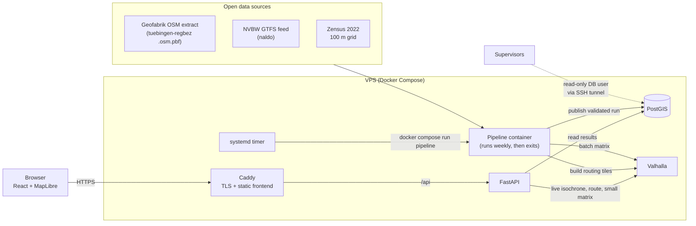

# Architecture — reach (15-Minute City Tübingen)

> **Status:** draft v0.2 (2 Nov 2026). Describes the target architecture the team builds towards.
> Settled and open decisions are listed in [Section 13](#13-decisions); items marked **[OPEN]**
> must be settled before the related code is written. Methodology (scoring formula, thresholds, validation
> experiments) is defined in [`architecture_proposal.md`](architecture_proposal.md) §5 and §8 and
> is not repeated here.

---

## 1. Goal in one paragraph

`reach` measures how well residents of Tübingen can reach everyday services within 15 minutes on
foot or by bike, identifies underserved neighbourhoods, and recommends where new facilities would
help the most people. It runs as a hosted web application on a small external server. A scheduled
pipeline downloads open data, validates it, computes accessibility with **Valhalla** as the single
routing engine, and publishes the results to **PostGIS**, from where an API and a map frontend
serve them.

## 2. Architecture principles

1. **One routing engine: Valhalla.** Batch counting, isochrones, pin-drop routes and recommender
   catchments all use the same Valhalla instance and the same OSM snapshot, so numbers on the map
   and live answers always agree.
2. **Compute in batch, serve light.** Heavy work (routing graph build, accessibility counting,
   recommender) runs in the pipeline. At request time the server only reads results or answers
   small live queries (one isochrone, one small matrix).
3. **One data snapshot per run.** Every run uses one OSM extract, one GTFS feed and one census
   file, recorded with dates and checksums under a `run_id`.
4. **Native census grid.** The analysis unit is the official Zensus 2022 100 m grid. No
   re-gridding to H3, so population numbers stay exactly as published.
5. **A failed run never breaks the app.** New results become visible only after validation passes.
6. **Few services, clear contracts.** Four long-running services plus one run-to-completion
   pipeline container. Modules talk only through documented tables and files.
7. **Everything as code.** Docker images, Compose files, Valhalla config, scheduler and server
   setup live in the repository. A fresh server is up in under 30 minutes.

## 3. System overview



| Service | Runs | Responsibility |
|---|---|---|
| **Caddy** | always | HTTPS (Let's Encrypt), serves the built frontend, proxies `/api` |
| **FastAPI** | always | Read endpoints for results, live endpoints that call Valhalla |
| **PostGIS** | always | Results, reference data, run history, provenance |
| **Valhalla** | always | Routing: matrix, isochrone, route, expansion, locate |
| **Pipeline** | weekly + on demand | Acquire → validate → route → score → recommend → publish |

No job queue, no tile server, no self-hosted geocoder in Core (see [Section 12](#12-out-of-scope-for-core)).

## 4. Data sources

| Source | Provides | Format | Refresh | Licence |
|---|---|---|---|---|
| Geofabrik `tuebingen-regbez-latest.osm.pbf`, clipped to the city of Tübingen + routing buffer with `osmium extract` | Street and footpath network (Valhalla), facilities, district boundaries, land use, buildings | PBF | weekly (source updates daily) | ODbL 1.0 |
| NVBW GTFS (naldo, "mit Liniennetz") | Stops, weekday departures | GTFS zip | weekly | dl-de/by-2-0 and ODbL |
| Destatis Zensus 2022 grid | Residents per 100 m cell (EPSG:3035 cell IDs) | CSV zip | static | dl-de/by-2-0 |
| Elevation (only if gate G1 passes, **[OPEN: O7]**) | Slope for Valhalla | SRTM tiles via Valhalla, or state DGM | static | per source |

**Study area:** city of Tübingen (administrative boundary). Origins (census cells) and reported
results lie inside the boundary. The routing network and the facilities are taken from the
boundary plus a **routing buffer**, so residents near the city limit can reach facilities in
neighbouring municipalities (buffer size: see O13).

**One OSM file feeds everything.** Facilities, boundaries, land use and the Valhalla graph come
from the same clipped extract, so there is no dependency on Overpass or Nominatim at runtime and
no mismatch between POIs and the routing network.

Known data limits to document in the README and the validation report:
- Census values for small cells are perturbed (cell-key method); interpret at district level.
- Census counts main residences only (relevant for students in Tübingen) and reflects May 2022.
- OSM completeness varies by category (e.g. GP speciality, school type); checked in validation.

## 5. Spatial model

### 5.1 Coordinate reference systems

| Where | CRS | Why |
|---|---|---|
| Storage and all computation (DB, Parquet) | **EPSG:25832** (ETRS89 / UTM 32N) | Metres; correct distances and buffers in Baden-Württemberg |
| Census cell identifier | EPSG:3035 (original `GITTER_ID`) | Kept as key; geometry additionally stored in 25832 |
| API output and frontend | EPSG:4326 | GeoJSON / MapLibre; transformed with `ST_Transform` at query time |

Rule for code and agents: **data is converted to 25832 on ingest and to 4326 only at the API.**

### 5.2 Analysis unit

- **Origins:** populated Zensus 100 m cells inside the study area.
- **Origin point per cell:** centroid of residential buildings in the cell (OSM `building=*`),
  fallback cell centroid if the cell contains no mapped building. Cells whose origin snaps further than a set distance to a
  walkable edge are flagged (checked with Valhalla `/locate`).
- **Reporting units:** official city districts (Stadtteile) from OSM `boundary=administrative`
  (admin levels 9–11 in Tübingen), plus the native 100 m grid on the map. Coarser display levels
  use the census 1 km grid, not H3.

## 6. Routing with Valhalla

Valhalla is the only routing engine. It runs as a Docker container with prebuilt tiles stored in a
volume, so restarts never rebuild the graph.

### 6.1 Profiles

| Profile | Valhalla costing | Settings | Core? |
|---|---|---|---|
| Walking (inclusive) | `pedestrian` | `walking_speed` 3.39 km/h (850 m in 15 min), `step_penalty` for stairs | yes |
| Walking (comparison) | `pedestrian` | `walking_speed` 5.0 km/h | yes |
| Cycling | `bicycle` | bike type `Hybrid`, `use_hills` (default) | yes |
| Wheelchair / pram | `pedestrian` with `type: wheelchair` | avoids steps and steep sections | yes |

Profile parameters live in `config/config.yaml`, not in code. All profiles use **the same tile
set**: costing is chosen per request, so adding a profile never requires a second graph.

### 6.2 Endpoints used and what for

| Valhalla endpoint | Used by | Purpose |
|---|---|---|
| `sources_to_targets` (matrix) | pipeline, API | Count reachable facilities per cell; recommender catchments; residents reaching a facility |
| `isochrone` | API | Draw 5/10/15-minute areas on the map (display only, never used for counting) |
| `route` | API | Route line and time for the pin-drop inspector |
| `expansion` | API | Visualise how the 15-minute reach spreads along streets |
| `locate` | pipeline | Validate where census origins and facilities snap to the network |
| `status` | Compose healthcheck | Liveness |

### 6.3 Counting method (decision D2: network counting)

For every populated cell *i*, category *c* and profile *m*:

1. **Prefilter by straight-line distance.** Network distance is never shorter than the straight
   line, so only facilities within the maximum reachable distance are candidates
   (walking 3.39 km/h: 850 m for facilities, 565 m for stops; cycling: speed × 15 min). The
   prefilter is exact: no reachable facility is dropped.
2. **Matrix request** with the cell origin as source and the candidates as targets
   (direction cell → facility, which stays correct if slopes are added later).
3. **Count** targets with travel time ≤ budget → raw count `A[i,c,m]`, plus the time to the
   nearest facility.
4. **Store raw counts and nearest times.** Classes and deficits are derived at read time from the
   thresholds in config (scoring spec, `architecture_proposal.md` §5), so changing a threshold
   never requires re-routing.

Public transport supply: stops reachable within 10 minutes are found with the same matrix step;
their scheduled weekday departures are summed from GTFS with pandas (no transit routing in Core).

Batching: requests are grouped by cell blocks and run in parallel against the local Valhalla.
Matrix limits are raised in our Valhalla config to fit these batches.

### 6.4 Recommender catchments

For a candidate location *x*, the catchment is the set of cells that reach *x* within the budget:
matrix with nearby cells as sources and *x* as target. The greedy recommender
(`architecture_proposal.md` §9) uses these catchments to compute marginal gains. Candidates come
from high-deficit areas and are filtered by OSM land use (no water, forest, farmland, industrial,
protected areas).

### 6.5 Using Valhalla efficiently

The server has 4 GB RAM, so every Valhalla call must be cheap. Rules:

**Batch counting (pipeline)**

1. **One matrix for all categories.** Per request, send all facilities (all categories) within
   the prefilter radius as targets and split the counts by category afterwards. Never one request
   per category.
2. **Block requests spatially.** Group cells into blocks (e.g. 500 m × 500 m). Sources = cells
   in the block, targets = all facilities within block bbox + maximum reach. Fewer, larger
   requests instead of one request per cell; block size is tuned to the matrix limits in
   `config/valhalla.json`.
3. **Exact prefilter by profile.** Maximum reach = speed × time budget (walking 3.39 km/h: 850 m;
   cycling: speed × 15 min). Facilities outside are never sent.
4. **Compact responses.** Request only time (and distance if needed); use the compact matrix
   output where the Valhalla version supports it.
5. **Parallel, bounded.** Async client with a concurrency limit equal to Valhalla's worker
   threads; retries on timeouts.
6. **Same requests serve several outputs.** The counting matrix also yields nearest-facility
   times and the stop list for transit supply, so no separate pass is needed.
7. **Recommender catchments in blocks.** Candidates are processed in groups: sources = cells near
   the group, targets = all candidates of the group, one request per group.

**Live endpoints (API)**

8. **Answer from precomputed data first.** The pin-drop inspector looks up the census cell under
   the pin and returns its precomputed counts and nearest times from PostGIS (identical to the
   map). Valhalla is only called for what cannot be precomputed: the isochrone polygon and the
   route lines to the nearest facility per category.
9. **One isochrone call for all rings.** 5, 10 and 15 minutes are requested as contours in a single
   call, with `generalize` and `denoise` set to keep polygons small.
10. **Cache by cell.** Live isochrones and catchments are cached per (cell, profile); repeated
    clicks in the same cell never hit Valhalla twice.
11. **Expensive calls on demand only.** `expansion` is only called when the user opens the
    "spread" view and is limited to the 15-minute budget.
12. **Validate before routing.** Points outside the study area are rejected before any Valhalla call.

**Valhalla service**

13. **Tiles as one extract.** Tiles are packed into a single `valhalla_tiles.tar` and memory-mapped
    by the service, which keeps RAM use low and startup fast.
14. **Tuned limits.** `config/valhalla.json` sets matrix, isochrone and locate limits for our batch
    sizes and a moderate tile cache; worker threads match the server's vCPUs.
15. **Batch validation calls.** `locate` is called with many points per request when checking
    census origins and facilities.

## 7. Pipeline

One Python package, one entry point, idempotent stages. Each stage writes its outputs plus a
manifest; the next stage checks the manifest before it starts.


| Stage | Input | Output | Notes |
|---|---|---|---|
| `acquire` | config | raw files in `data/raw/<run_id>/`, provenance (URL, date, checksum, licence) | Skips download if checksum unchanged; retries with backoff |
| `validate inputs` | raw files | cleaned layers (GeoParquet, EPSG:25832), validation report part 1 | Fails loudly on schema or plausibility errors |
| `build tiles` | clipped PBF | `valhalla_tiles.tar` in the shared volume | Only when the OSM snapshot changed; see 11.1 |
| `count` | cells, facilities, stops, Valhalla | raw counts and nearest times per cell × category × profile | Section 6.3 |
| `score` | raw counts, config thresholds | classes, deficits per cell and district | Scoring spec |
| `recommend` | deficits, catchments | ranked candidate zones with population gain | Greedy, land-use filtered |
| `validate results` | all results | validation report part 2 | Monotonicity, totals, sample checks |
| `publish` | validated results | new DB schema `run_<id>`, then `current` view switched | Atomic; previous run stays available |

Commands:
- `make pipeline` — full run (same command the scheduler calls).
- `make pipeline STAGE=count` — single stage for development.

Intermediate files are GeoParquet/Parquet in `data/` (git-ignored). Only `publish` writes to PostGIS.

## 8. Database (PostGIS)

Schemas:
- `run_<id>` — one schema per published run (results and the reference data used).
- `current` — views pointing at the latest validated run. The API reads only from `current`.
- `meta` — `runs` (id, start, end, status, snapshot dates), `data_sources` (provenance).

Core tables per run (column details go into `docs/data_contract.md`, the binding contract between
pipeline and API):

| Table | Grain | Key columns |
|---|---|---|
| `cells` | census cell | `cell_id` (3035 id), `population`, `district_id`, `geom` (25832), `origin_geom`, `flags` |
| `facilities` | facility | `facility_id` (OSM type/id), `category`, `name`, `geom` |
| `stops` | GTFS stop | `stop_id`, `weekday_departures`, `geom` |
| `access_counts` | cell × category × profile | `count`, `nearest_min` |
| `scores` | cell × category × profile | `class`, `deficit` |
| `district_scores` | district × category × profile | `share_lack`, `share_sufficient`, `deficit_sum` |
| `recommendations` | candidate × category × profile | `rank`, `population_gain`, `geom` |
| `validation_report` | check | `check`, `status`, `value`, `message` |

Roles: `app_read` (API), `pipeline_write` (pipeline), `supervisor_read` (read-only, for the
supervisors via SSH tunnel; course requirement).

## 9. API (FastAPI)

Read endpoints (from `current`):
- `GET /api/meta` — run id, data dates, validation summary.
- `GET /api/districts`, `GET /api/districts/{id}/scores`
- `GET /api/cells?category=&profile=` — cell results for the map as GeoJSON (PMTiles later only if the payload becomes too large)
- `GET /api/recommendations?category=&profile=`

Live endpoints (call Valhalla, small and fast, no queue):
- `POST /api/inspect` — pin-drop: isochrone + reachable facilities per category with times + weakest category.
- `POST /api/catchment` — facility or candidate: isochrone + residents reaching it.
- `POST /api/expansion` — street-level spread for visualisation.

Live endpoints validate that the point lies inside the study area and enforce simple rate limits.

## 10. Frontend

React + TypeScript + MapLibre GL JS, built with Vite to static files served by Caddy (no Node
process on the server). deck.gl only if a specific layer needs it. Views: accessibility map
(per category, profile, class), district ranking, pin-drop inspector, recommendations, data &
validation page (sources, snapshot dates, warnings). OSM, GTFS, Zensus and basemap attribution is
always visible.

## 11. Deployment and operations

| Topic | Choice |
|---|---|
| Host | External VPS, **Hetzner Cloud CX23** (2 vCPU, 4 GB RAM, 40 GB, x86), Ubuntu LTS, Docker Engine + Compose, 2–4 GB swap |
| Budget | 20 € in total. CX23 ≈ 7.13 €/month incl. VAT and IPv4 → start the server when the first deployable version exists (target: around 20 Nov) and delete it after grading |
| Images | Built by GitHub Actions for `linux/amd64`, pushed to GHCR, tagged with git SHA and release tag |
| Deploy | `make deploy`: SSH → `docker compose -f compose.prod.yaml pull && up -d` (manual trigger) |
| Valhalla tiles | See 11.1 |
| Scheduler | systemd timer, weekly (Monday 03:00 UTC), runs `docker compose run --rm pipeline`; `flock` prevents overlaps; logs in the journal |
| HTTPS | Caddy with Let's Encrypt; free hostname via `sslip.io` for now, own domain later if wanted |
| Firewall | Hetzner Cloud Firewall: only 22, 80, 443; PostGIS not exposed |
| Access | SSH keys for the three team members; no password or root login |
| Backups | Nightly `pg_dump` to a volume; results are reproducible from the pipeline |
| Restarts | `restart: unless-stopped` and healthchecks on all services |
| Monitoring | App shows data date and last run status; a failed run posts to the team chat via webhook (URL in `.env`) |

### 11.1 Where Valhalla tiles are built

| Option | When | Notes |
|---|---|---|
| **On the server inside the pipeline** (default for the weekly refresh) | Tübingen + buffer clip | The clipped extract is a few MB, so the build is small; must be confirmed on the CX23 with swap **[VERIFY]**. Keeps the weekly refresh fully automatic. |
| **bwUniCluster** (temporary access) | larger areas, experiments, elevation tests, one-off heavy builds | No Docker on the cluster; run the Valhalla image with Apptainer **[VERIFY]**. Copy the resulting `valhalla_tiles.tar` to the server. Not used for the scheduled refresh, because access is temporary. |
| **Laptop / GitHub Actions** | fallback if the server build does not fit | Same output file, uploaded to the server volume. |

Tiles do not depend on the CPU architecture of the build machine in practice, but the build is
reproduced on the server image before release **[VERIFY]**.

Environments:

| Environment | How | Data |
|---|---|---|
| Local | `make up` (`compose.yaml`, hot reload for API and web) | Tübingen or a small test clip |
| CI | lint + unit tests; integration test on a ~1 km² clip | Fixtures in the repo |
| Production | `compose.prod.yaml` on the VPS | Tübingen, weekly refresh |

## 12. Out of scope for Core

Cut first if time is short; can be added later without changing the architecture:
job queue / live scenario recomputation, self-hosted geocoder (map click and district picker
instead), transit routing (Valhalla multimodal or r5py), elevation unless gate G1 passes,
H3 aggregation, second region, Prefect/Dagster, monitoring stack.

## 13. Decisions

### Settled (2 Nov 2026)

| ID | Decision |
|---|---|
| O1 | Budget 20 € in total → Hetzner CX23 (4 GB), started when needed, deleted after grading |
| O2 | No own domain for now; free hostname (`sslip.io`) for HTTPS |
| O3 | Valhalla runs permanently on the server (live pin-drop, isochrones) |
| O4 | Tiles built in the pipeline for the clipped area; bwUniCluster for heavy or experimental builds (Section 11.1) |
| O5 | Origin = residential building centroid per cell, fallback cell centroid |
| O6 | Core profiles: walking (3.39 and 5.0 km/h), cycling, wheelchair |
| O8 | Coarse facility categories (≈ 7) in Core |
| O9 | Map data as GeoJSON from the API first |
| O10 | Failed runs notify the team chat via webhook |
| O11 | Study area = city of Tübingen; routing buffer around it |
| O12 | English documentation; branches `main` (releases) + `dev` (integration) |
| — | Focus on efficient use of Valhalla endpoints (Section 6.5) |

### Open

| ID | Question | Options | Proposal |
|---|---|---|---|
| O7 | Elevation (slopes) in walking/cycling times | Off in Core; on after gate G1 test; own Tobler model | Off in Core, short G1 test decides |
| O13 | Size of the routing buffer | 2 km for all profiles; buffer = maximum reach per profile (walking ≈ 1 km, cycling ≈ 4 km) | Buffer = maximum cycling reach (≈ 4 km), otherwise cycling reach at the city edge is cut off |
| O14 | Team chat for the webhook | Discord, Slack, Telegram, Matrix, … | – |
| O15 | Cycling speed | Valhalla default for `Hybrid`; fixed value (e.g. 15 km/h, as in the old config) | Fixed 15 km/h, documented |

## 14. Repository layout

```
reach/
├── AGENTS.md              # short rules for coding agents (commands, always / ask / never)
├── README.md              # purpose, architecture diagram, quickstart, deployment
├── Makefile               # up, down, pipeline, test, lint, deploy
├── compose.yaml           # local development
├── compose.prod.yaml      # production (GHCR images, Caddy)
├── .env.example
├── config/
│   ├── config.yaml        # study area, profiles, categories + OSM tags, thresholds, validation rules
│   └── valhalla.json      # Valhalla service limits and options
├── pipeline/              # Python package: acquire, validate, tiles, count, score, recommend, publish
├── api/                   # FastAPI app (read + live endpoints)
├── web/                   # React + MapLibre frontend
├── infra/                 # Caddyfile, DB roles/migrations, systemd timer, server setup script
├── tests/                 # unit, data-contract and integration tests
├── docs/                  # architecture, data contract, scoring spec, decisions, meeting notes
└── .github/               # CI workflows, CODEOWNERS, PR template
```
