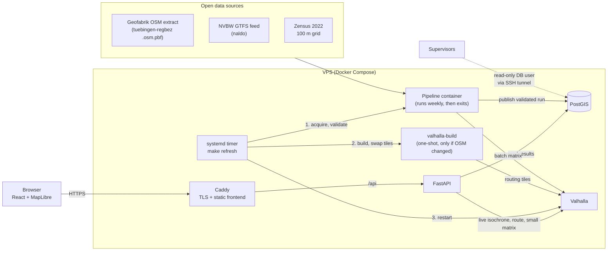

# Architecture — reach (15-Minute City Tübingen)

> **Status:** draft v0.20 (9 Nov 2026). Describes the target architecture the team builds towards.
> Every change bumps the version and adds a line to the [Change log](#change-log).
> Settled and open decisions are listed in [Section 13](#13-decisions); items marked **[OPEN]**
> must be settled before the related code is written. Methodology (categories, thresholds,
> scoring, recommender, validation experiments) is defined in [`methodology.md`](methodology.md)
> and is not repeated here.

---

## 1. Goal in one paragraph

`reach` measures how well residents of Tübingen can reach everyday services within 15 minutes on
foot or by bike, identifies underserved neighbourhoods, and recommends where new facilities would
help the most people. It runs as a hosted web application on a small external server. A scheduled
pipeline downloads open data, validates it, computes accessibility with **Valhalla** as the single
routing engine, and publishes the results to **PostGIS**, from where an API and a map frontend
serve them.

## 2. Architecture principles

1. **One routing engine: Valhalla.** Batch counting, isochrones, pin-drop routes and recommender
   catchments all use the same Valhalla instance and the same OSM snapshot, so numbers on the map
   and live answers always agree.
2. **Compute in batch, serve light.** Heavy work (routing graph build, accessibility counting,
   recommender) runs in the pipeline. At request time the server only reads results or answers
   small live queries (one isochrone, one small matrix).
3. **One data snapshot per run.** Every run uses one OSM extract, one GTFS feed and one census
   file, recorded with dates and checksums under a `run_id`.
4. **Native census grid.** The analysis unit is the official Zensus 2022 100 m grid. No
   re-gridding to H3, so population numbers stay exactly as published.
5. **A failed run never breaks the app.** New results become visible only after validation passes.
6. **Few services, clear contracts.** Four long-running services plus two run-to-completion
   containers (pipeline, tile build). Modules talk only through documented tables and files.
7. **Everything as code.** Docker images, Compose files, Valhalla config, scheduler and server
   setup live in the repository. A fresh server is up in under 30 minutes.

## 3. System overview



| Service | Runs | Responsibility |
|---|---|---|
| **Caddy** | always | HTTPS (Let's Encrypt), serves the built frontend, proxies `/api` |
| **FastAPI** | always | Read endpoints for results, live endpoints that call Valhalla |
| **PostGIS** | always | Results, reference data, run history, provenance |
| **Valhalla** | always | Routing: matrix, isochrone, route, expansion |
| **Pipeline** | weekly + on demand | Acquire → validate → route → score → recommend → publish |
| **valhalla-build** | only when the OSM snapshot changed | One-shot tile build (same official Valhalla image), started from the host by `make refresh`, see Section 7 |

No job queue, no tile server, no self-hosted geocoder in Core (see [Section 12](#12-out-of-scope-for-core)).

## 4. Data sources

| Source | Provides | Format | Refresh | Licence |
|---|---|---|---|---|
| Geofabrik `tuebingen-regbez-latest.osm.pbf`, clipped to the city of Tübingen + routing buffer with `osmium extract` | Street and footpath network (Valhalla), facilities, district boundaries, land use | PBF | weekly (source updates daily) | ODbL 1.0 |
| NVBW GTFS (naldo, "mit Liniennetz") | Stops, weekday departures | GTFS zip | weekly | dl-de/by-2-0 and ODbL |
| Destatis Zensus 2022 grid | Residents per 100 m cell (EPSG:3035 cell IDs) | CSV zip | static | dl-de/by-2-0 |
| Elevation tiles (SRTM-based, downloaded by Valhalla with `build_elevation`) | Height per edge, stored in the routing tiles | Valhalla elevation tiles (1° × 1°, two tiles cover Tübingen + buffer) | static, downloaded once and kept in the volume | per source, attribution in README |

**Study area: the city of Tübingen; the urban boundary shapes the map.** Every resident of
Tübingen is scored, so no populated part of the city drops out of the results. The **urban
(settlement) boundary** only marks where the city is built up, which matters for the map, the
live endpoints and the recommender, not for who is scored (decision O11).

- **Scoring scope:** all populated census cells whose centroid lies inside the administrative
  city boundary get 15-minute accessibility scores and deficits, including isolated farms and
  hamlets outside the built-up area. `validate` checks the coverage: residents of scored cells
  ÷ residents of all populated cells that touch the city area ≥ `validation.min_scored_share`
  (0.98); excluded residents are listed per district in the validation report.
- **Urban boundary:** derived in the pipeline from the OSM extract and stored per run
  (definition: decision O17). It determines only the area drawn as the city on the map, the
  boundary check of the live endpoints (9) and where recommender candidates may lie
  (`methodology.md` §5).
- **Routing buffer:** the routing network and the facilities are taken from the city boundary
  plus a **4 km buffer** (covers the maximum cycling reach of 3.75 km, see 6.1), so residents at
  the edge can reach facilities outside it, including neighbouring municipalities. The config
  loader checks that the buffer is at least the largest prefilter reach of all profiles,
  including speed factor and margin (6.3); if the cycling factor measured in the count stage
  makes the reach larger than 4 km, a larger buffer is proposed and changed in `config/` after
  confirmation (decisions O13, O20).
- **Administrative boundary:** defines the scoring scope and the routing area, clips the urban
  boundary to the city and carries the district reporting (5.2).

**One OSM file feeds everything.** Facilities, boundaries, land use and the Valhalla graph come
from the same clipped extract, so there is no dependency on Overpass or Nominatim at runtime and
no mismatch between POIs and the routing network.

Known data limits to document in the README and the validation report:
- Census values for small cells are perturbed (cell-key method); interpret at district level.
- Census counts main residences only (relevant for students in Tübingen) and reflects May 2022.
- OSM completeness varies by category (e.g. GP speciality, school type); checked in validation.

## 5. Spatial model

### 5.1 Coordinate reference systems

| Where | CRS | Why |
|---|---|---|
| Storage and all computation (DB, Parquet) | **EPSG:25832** (ETRS89 / UTM 32N) | Metres; correct distances and buffers in Baden-Württemberg |
| Census cell identifier | EPSG:3035 (original `GITTER_ID`) | Kept as key; geometry additionally stored in 25832 |
| API output and frontend | EPSG:4326 | GeoJSON / MapLibre; transformed with `ST_Transform` at query time |

Rule for code and agents: **data is converted to 25832 on ingest and to 4326 only at the API.**

### 5.2 Analysis unit

- **Origins:** populated Zensus 100 m cells whose centroid lies inside the city boundary (Section 4).
- **Origin point per cell:** the **cell centroid**, transformed to EPSG:25832. Valhalla snaps it
  to the nearest edge of the network for each request. This is the Core choice because it is
  simple, reproducible and independent of OSM building completeness. Known limit: in partly built
  cells (edge of town, slopes, rivers) the centroid can be up to ~70 m (≈ 1 min walking) away
  from where people live. A building-based origin and snap checks are noted as future work in
  [`notes.md`](notes.md).
- **Reporting units:** official city districts (Stadtteile) from OSM `boundary=administrative`
  (admin levels 9–11 in Tübingen), plus the native 100 m grid on the map. Coarser display levels
  use the census 1 km grid, not H3.

## 6. Routing with Valhalla

Valhalla is the only routing engine. It runs as a Docker container with prebuilt tiles stored in a
volume, so restarts never rebuild the graph.

### 6.1 Profiles

| Profile | Valhalla costing | Settings | Core? |
|---|---|---|---|
| Walking (inclusive) | `pedestrian` | `walking_speed` 3.39 km/h (850 m in 15 min), `step_penalty` for stairs | yes |
| Walking (comparison) | `pedestrian` | `walking_speed` 5.0 km/h | yes |
| Cycling | `bicycle` | bike type `Hybrid`, `cycling_speed` 15 km/h, `use_hills` (default) | yes |
| Wheelchair / pram | `pedestrian` with `type: wheelchair` | `walking_speed` 3.39 km/h, avoids steps; does **not** avoid steep sections (`max_grade` has no effect in 3.9.1, notes N11) | yes |

**Elevation is built in, and Valhalla applies it to every profile.** The tiles are always built
with elevation data (`build_elevation`), so every edge carries its grade (checked by `tiles
verify`, VF1). Valhalla 3.9.1 uses the grades in all costings we use; we keep its default
behaviour (O7, notes N5):

| Profile | What Valhalla does with elevation | Evidence (Valhalla 3.9.1, Tübingen tiles) |
|---|---|---|
| Walking (both speeds) | `pedestrian` costing scales the time of each edge by a grade factor: uphill and steep downhill are slower, gentle downhill slightly faster; `walking_speed` is the flat-ground speed. `use_hills` and `max_grade` do not change the times | Burgholzweg 127 → Waldkindergarten (697 m): 984 s uphill, 769 s back, 740 s on flat ground (3.39 km/h); Marktplatz → Schloss (506 m): 681 s / 619 s vs. 537 s; 300 random routes: median 1.08 × the flat-ground time (0.91–1.66) |
| Wheelchair | same grade factor as walking; `type: wheelchair` changes the route (no steps), not the factor. `max_grade` (unset, 1, 4, 6, 12 or 30) excludes no edges: routes keep sections of 12–20 % grade, far above ramp guidelines (DIN 18040: 6 %), so wheelchair counts are optimistic on hillsides (known limitation, `methodology.md` §1, notes N11) | Burgholzweg 127 → Waldkindergarten (627 m without steps): 881 s uphill, 700 s back, 666 s on flat ground; 235 random routes: median 1.06 (0.94–1.79) |
| Cycling | `bicycle` costing slows uphill and speeds up downhill; `use_hills` stays at the default (0 and default give the same times) | Marktplatz → Schloss 677 s / 591 s; Hbf → Waldhäuser-Ost 1,196 s / 865 s (VF2) |

Stairs are always handled through OSM `highway=steps`. Slope-free walking times would need a
second, elevation-free tile set (against "same tile set" below); they are only computed once
for the validation experiment V11 (`methodology.md` §6), not served.

**Maximum reach per profile** (speed × time budget), the basis of the prefilter (6.3, where
cycling adds a measured speed factor) and of the routing buffer (Section 4):

| Profile | Facilities (15 min) | Transit stops (10 min) |
|---|---|---|
| Walking 3.39 km/h | 850 m | 565 m |
| Walking 5.0 km/h | 1,250 m | 835 m |
| Wheelchair 3.39 km/h | 850 m | 565 m |
| Cycling 15 km/h | 3,750 m | – (transit supply is measured on foot or by wheelchair only) |

Profile parameters live in `config/config.yaml`, not in code. All profiles use **the same tile
set**: costing is chosen per request, so adding a profile never requires a second graph.

### 6.2 Endpoints used and what for

| Valhalla endpoint | Used by | Purpose |
|---|---|---|
| `sources_to_targets` (matrix) | pipeline, API | Count reachable facilities per cell; recommender catchments; residents reaching a facility |
| `isochrone` | API | Draw 5/10/15-minute areas on the map (display only, never used for counting) |
| `route` | API | Route line and time for the pin-drop inspector |
| `expansion` | API | Visualise how the 15-minute reach spreads along streets |
| `status` | Compose healthcheck | Liveness |

### 6.3 Counting method (decision D2: network counting)

For every populated cell *i*, category *c* and profile *m*:

1. **Prefilter by straight-line distance.** Network distance is never shorter than the straight
   line, so only facilities within the prefilter reach of the profile are candidates:
   `reach = speed × max_speed_factor × budget + prefilter_margin_m` (both values per profile in
   `config/config.yaml`). Walking and wheelchair use factor 1.0 and margin 0 (table in 6.1),
   which is exact up to the snap distance (Valhalla does not count the way from a point to its
   snapped edge as travel time); the margin stays 0 until the count stage shows facilities
   reachable beyond the nominal reach, then a value is proposed and set after confirmation.
   Cycling uses a factor derived from measured maximum speeds in Valhalla's bicycle costing,
   because it can exceed 15 km/h downhill. With these values no reachable facility is dropped
   (decision O20).
2. **Matrix request** with the cell origin as source and the candidates as targets
   (direction cell → facility, which stays correct when slopes are used, because uphill and
   downhill times differ).
3. **Count** targets with travel time ≤ budget → raw count `A[i,c,m]`, plus the time to the
   nearest facility.
4. **Store raw counts and nearest times.** Classes and deficits are derived at read time from the
   thresholds in config (scoring, `methodology.md` §4), so changing a threshold
   never requires re-routing.

Public transport supply: stops reachable within 10 minutes on foot (walking and wheelchair
profiles) are found with the same matrix step; their scheduled departures on a **reference
weekday** are summed from GTFS with pandas (no transit routing in Core). Only the raw sum per
cell and profile is stored (`transit_supply`); transit classes are derived at read time like the
facility classes (§8). The reference weekday is chosen automatically as a regular Tuesday
inside the feed's validity period that is not a public or school holiday; `calendar.txt` and
`calendar_dates.txt` exceptions are applied. The chosen date is stored in the run metadata.

Batching: requests are grouped by cell blocks and run in parallel against the local Valhalla.
Matrix limits are raised in our Valhalla config to fit these batches.

### 6.4 Recommender catchments

For a candidate location *x*, the catchment is the set of cells that reach *x* within the budget:
matrix with nearby cells as sources and *x* as target. The greedy recommender
(`methodology.md` §5) uses these catchments to compute marginal gains. Candidates are 100 m
Zensus grid cells inside the urban boundary near cells with a deficit, filtered by OSM land use
(no water, forest, farmland, nature reserves, protected areas with `protect_class` 1–4 or 7;
tags and classes in `config/config.yaml`, read with osmium from the run's clipped PBF; other
protected areas are only counted in `report_recommend.json`). Catchments depend on the profile only, so one set of matrices per profile
serves all categories (rule 7). The catchments of the recommended zones are stored
(`recommendation_catchments`), so `/api/catchment` shows exactly the cells the recommender used.

### 6.5 Using Valhalla efficiently

The server has 4 GB RAM, so every Valhalla call must be cheap. Rules:

**Batch counting (pipeline)**

1. **One matrix for all categories.** Per request, send all facilities (all categories) within
   the prefilter radius as targets and split the counts by category afterwards. Never one request
   per category.
2. **Block requests spatially.** Group cells into blocks (e.g. 500 m × 500 m). Sources = cells
   in the block, targets = all facilities within block bbox + prefilter reach. Fewer, larger
   requests instead of one request per cell; block size is tuned to the matrix limits in
   `config/valhalla.json`.
   Every matrix request uses `costmatrix` (`thor.source_to_target_algorithm`; Valhalla 3.9.1
   selects the algorithm only in the service config, not per request). `select_optimal` would
   answer single-cell blocks and one-source requests with `timedistancematrix`, which misses
   wheelchair routes that `/route` finds (notes N8).
3. **Prefilter by profile (O20).** Prefilter reach = speed × speed factor × time budget + margin
   (6.3). Facilities outside are never sent.
4. **Compact responses.** Request only time (and distance if needed); use the compact matrix
   output where the Valhalla version supports it.
5. **Parallel, bounded.** Async client with a concurrency limit equal to Valhalla's worker
   threads; retries on timeouts.
6. **Same requests serve several outputs.** The counting matrix also yields nearest-facility
   times, the reachable facilities per cell with their times (`reachable`) and the stop list
   for transit supply, so no separate pass is needed.
7. **Recommender catchments in blocks.** Candidates are processed in groups: sources = cells near
   the group, targets = all candidates of the group, one request per group.

**Live endpoints (API)**

8. **Answer from precomputed data first.** The pin-drop inspector snaps the pin to the 100 m
   Zensus grid cell under it (id computed from EPSG:3035) and returns that cell's precomputed
   counts, nearest times and classes from PostGIS (identical to the map). Valhalla is only
   called for what cannot be precomputed: the isochrone polygon and the route lines to the
   nearest facility per category. For scored cells the reachable facilities with times and
   the nearest one come from `current.reachable` (written by `count` from the same matrix),
   so the inspector matches the map by construction. Only grid cells without residents get
   one live matrix (`costmatrix`, the run's costing, prefilter O20), marked as live. **All
   calls start from the cell's origin point** (the cell centre), not from the raw click
   position, so polygon, routes and counts always describe the same start and can be cached
   per cell; this also holds for grid cells without residents (parks, fields), whose answer
   says that no precomputed values exist there.
9. **One isochrone call for all rings.** 5, 10 and 15 minutes are requested as contours in a single
   call, with `generalize` and `denoise` set to keep polygons small.
10. **Cache by cell.** Live isochrones and catchments are cached per (cell, profile); repeated
    clicks in the same cell never hit Valhalla twice.
11. **Expensive calls on demand only.** `expansion` is only called when the user opens the
    "spread" view and is limited to the 15-minute budget.
12. **Validate before routing.** A point is accepted if it **or the centre of its grid cell**
    lies inside the city boundary (the union of the districts), **or** inside a scored cell;
    every other point is rejected before any Valhalla call. Every live answer carries the cell
    `status`: `scored`, `unpopulated` (centre in the city, no residents in the Zensus grid) or
    `outside_city` (centre outside the city boundary, never scored under O11, answered live).

**Valhalla service**

13. **Tiles as one extract.** Tiles are packed into a single `valhalla_tiles.tar` and memory-mapped
    by the service, which keeps RAM use low and startup fast.
14. **Internal only.** Valhalla listens only on the internal Docker network; port 8002 is never
    published on the server. All external access goes through the API.
15. **Tuned limits.** `config/valhalla.json` sets matrix and isochrone limits for our batch
    sizes and a moderate tile cache; worker threads match the server's vCPUs.

## 7. Pipeline

One Python package, one entry point, idempotent stages. Each stage writes its outputs plus a
manifest; the next stage checks the manifest before it starts.


| Stage | Input | Output | Notes |
|---|---|---|---|
| `acquire` | config | raw files in `data/raw/<run_id>/`, provenance (URL, date, checksum, licence) | Skips download if checksum unchanged; retries with backoff |
| `validate inputs` | raw files | cleaned layers (GeoParquet, EPSG:25832), validation report part 1 | Fails loudly on schema or plausibility errors |
| `tiles` | clipped PBF, cached elevation tiles | `valhalla_tiles.tar` (with elevation) in the shared volume | The pipeline stage only checks whether a rebuild is needed and verifies the tiles after the restart; the build itself is the one-shot `valhalla-build` started by `make refresh` on the host (O19), only when the OSM snapshot changed; see below and 11.1 |
| `count` | cells, facilities, stops, Valhalla | raw counts and nearest times per cell × category × profile | Section 6.3 |
| `score` | raw counts, config thresholds | `thresholds` table; classes and deficits as views over the raw counts (§8) | `methodology.md` §4; the pipeline writes no derived score tables |
| `recommend` | counts, cells, urban boundary, clipped PBF, Valhalla | ranked candidate zones with population gain and their catchments | Greedy per category × profile (`recommend.profiles`), land-use filtered; §6.4 |
| `validate results` | all results | validation report part 2 | Monotonicity, totals, sample checks; `reachable` gives exactly the counts; calls Valhalla /route for a sample of counted pairs (`matrix_vs_route`), a sample of uncounted pairs within the prefilter reach (`false_negatives`) and reports the budget flips of both (methodology V10) |
| `publish` | validated results | new DB schema `run_<id>`, then `current` view switched | Atomic; previous run stays available |
| `cleanup` | run history | – | Keeps the last 3 published runs (DB schemas and `data/raw/<run_id>/`), deletes older ones; 40 GB disk |

**Tile rebuild without breaking the live service.** The `build tiles` stage runs as a separate
one-shot Compose service (`valhalla-build`, same official Valhalla image) and writes
`valhalla_tiles.new.tar`. Only after the build succeeds is the file swapped in (old file kept as
`valhalla_tiles.prev.tar` for rollback) and the Valhalla service restarted, which takes seconds.
Counting then runs against the new graph.

**Orchestration on the host (decision O19).** One command, `make refresh`, runs a full refresh:
pipeline `acquire` and `validate` → `valhalla-build` (only if the clipped PBF changed) → atomic
tile swap → Valhalla restart and health check → pipeline `count` … `cleanup`. The pipeline
container has **no access to the Docker socket**; it only reports whether a rebuild is needed
and verifies the tiles after the restart. The systemd timer calls exactly this command. Between restart and `publish`, live isochrones already
use the new graph while the map still shows the previous run; the weekly run is scheduled at night
to keep this window irrelevant. If the snapshot did not change, no rebuild and no restart happen.

Commands:
- `make refresh` — full refresh incl. tile build, swap and Valhalla restart (the command the
  scheduler calls).
- `make pipeline` — all pipeline stages against the running Valhalla, without a tile rebuild.
- `make pipeline STAGE=count` — single stage for development.

Intermediate files are GeoParquet/Parquet in `data/` (git-ignored). Only `publish` writes to PostGIS;
`cleanup` only drops old run schemas and their `meta` rows.

## 8. Database (PostGIS)

Schemas:
- `run_<id>` — one schema per published run (results and the reference data used).
- `current` — views pointing at the latest validated run. The API reads only from `current`.
- `meta` — `runs` (id, start, end, status, snapshot dates), `data_sources` (provenance).

Core tables per run (column details go into `docs/data_contract.md`, the binding contract between
pipeline and API):

| Table | Grain | Key columns |
|---|---|---|
| `cells` | census cell | `cell_id` (3035 id), `population`, `district_id`, `geom` (25832), `origin_geom` (cell centroid) |
| `facilities` | facility | `facility_id` (OSM type/id), `category`, `name`, `geom` |
| `stops` | GTFS stop | `stop_id`, `weekday_departures`, `geom` |
| `access_counts` | cell × category × profile | `count`, `nearest_min` |
| `reachable` | cell × profile × facility within the budget | `time_s` (matrix time, the list behind `count`) |
| `transit_supply` | cell × profile (walking and wheelchair only) | `departures` (raw sum on the reference weekday), `stops_count`, `nearest_stop_min` |
| `thresholds` | category (and transit class) | `k`, class bounds — copied from config at publish |
| `scores` (**view**) | cell × category × profile | `class`, `deficit`, computed from `access_counts` + `thresholds` |
| `transit_scores` (**view**) | cell × profile | transit `class`, computed from `transit_supply` + `thresholds` |
| `district_scores` (**materialized view**) | district × category × profile | `share_lack`, `share_sufficient`, `deficit_sum`; refreshed on publish or when thresholds change |
| `recommendations` | recommended zone × category × profile | `rank`, `candidate_id`, `population_gain`, `residents_gaining_access`, `residents_to_sufficient`, `geom` (100 m zone), `point_geom` |
| `recommendation_catchments` | recommended zone × profile × cell | `time_s` (cells reaching the zone centre within the budget) |
| `validation_report` | check | `check`, `status`, `value`, `message` |

Roles: `app_read` (API), `pipeline_write` (pipeline), `supervisor_read` (read-only, for the
supervisors via SSH tunnel; course requirement).

## 9. API (FastAPI)

Read endpoints (from `current`):
- `GET /api/meta` — run id, data dates, validation summary.
- `GET /api/districts`, `GET /api/districts/{id}/scores`
- `GET /api/cells?category=&profile=` — cell results for the map as GeoJSON (PMTiles later only if the payload becomes too large)
- `GET /api/recommendations?category=&profile=`

Live endpoints (call Valhalla, small and fast, no queue):
- `POST /api/inspect` — pin-drop: precomputed values of the grid cell, isochrone, reachable
  facilities per category with times (one matrix), route to the nearest one per category,
  weakest category.
- `POST /api/catchment` — facility, point or recommended zone: reverse isochrone + residents
  reaching it (matrix from the scored cells within the prefilter reach; for a recommended zone
  the stored `recommendation_catchments`, rule 8).
- `POST /api/expansion` — street-level spread for visualisation.
- `POST /api/isochrone` — isochrone of the cell origin in one `direction` (`forward`: where you
  get; `reverse`: from where people reach the point; display only, rule 9); cached per (run,
  cell, profile, direction). `/api/inspect` keeps the forward one.

Live endpoints snap the point to its 100 m grid cell, accept it only inside the city boundary
or inside a scored cell (§6.5 rule 12), return the cell `status`, cache per (run, cell, profile) and
enforce a token-bucket rate limit per client IP (`X-Forwarded-For` trusted only from Caddy).
Read endpoints carry an ETag per run id. Response formats: `docs/data_contract.md`.

## 10. Frontend

React + TypeScript + MapLibre GL JS, built with Vite to static files served by Caddy (no Node
process on the server). deck.gl only if a specific layer needs it. Views: accessibility map
(per category, profile, class), district ranking, pin-drop inspector, recommendations, data &
validation page (sources, snapshot dates, warnings). OSM, GTFS, Zensus and basemap attribution is
always visible.

## 11. Deployment and operations

| Topic | Choice |
|---|---|
| Host | External VPS, **Hetzner Cloud CX23** (2 vCPU, 4 GB RAM, 40 GB, x86), Ubuntu LTS, Docker Engine + Compose, 2–4 GB swap |
| Budget | 20 € in total. CX23 ≈ 7.13 €/month incl. VAT and IPv4 (hourly billing, monthly cap). 20 € ≈ 2.8 months → **start the server around 1 Dec** (interim presentation on 25 Nov is shown locally or on a short-lived test server) and **delete it right after grading** (target mid-Feb). Test servers are created and deleted the same day |
| Memory budget (estimate, measure on first deploy **[VERIFY]**) | PostGIS ≈ 0.5 GB, Valhalla (memory-mapped clip) ≈ 0.5 GB, API ≈ 0.2 GB, Caddy < 0.1 GB, pipeline run ≈ 1–2 GB peak; plus 2–4 GB swap as safety margin |
| Images | Built by GitHub Actions for `linux/amd64`, pushed to GHCR, tagged with git SHA and release tag |
| Deploy | `make deploy`: SSH → `docker compose -f compose.prod.yaml pull && up -d` (manual trigger) |
| Valhalla tiles | See 11.1 |
| Scheduler | systemd timer, weekly (Monday 03:00 UTC), runs `make refresh` (Section 7); `flock` prevents overlaps; logs in the journal |
| HTTPS | Caddy with Let's Encrypt; free hostname via `sslip.io` for now, own domain later if wanted |
| Firewall | Hetzner Cloud Firewall: only 22, 80, 443; PostGIS not exposed |
| Access | SSH keys for the three team members; no password or root login |
| Backups | Nightly `pg_dump` to a volume; results are reproducible from the pipeline |
| Restarts | `restart: unless-stopped` and healthchecks on all services |
| Monitoring | App shows data date and last run status; a failed run posts to the team chat via webhook (URL in `.env`) |

### 11.1 Where Valhalla tiles are built

| Option | When | Notes |
|---|---|---|
| **On the server by `valhalla-build`, started by `make refresh`** (default for the weekly refresh, O19) | Tübingen + buffer clip | The clipped extract is a few MB, so the build is small; must be confirmed on the CX23 with swap **[VERIFY]**. Keeps the weekly refresh fully automatic. |
| **bwUniCluster** (temporary access) | larger areas, experiments, elevation tests, one-off heavy builds | No Docker on the cluster; run the Valhalla image with Apptainer **[VERIFY]**. Copy the resulting `valhalla_tiles.tar` to the server. Not used for the scheduled refresh, because access is temporary. |
| **Laptop / GitHub Actions** | fallback if the server build does not fit | Same output file, uploaded to the server volume. |

Tiles do not depend on the CPU architecture of the build machine in practice, but the build is
reproduced on the server image before release **[VERIFY]**.

Environments:

| Environment | How | Data |
|---|---|---|
| Local | `make up` (`compose.yaml`, hot reload for API and web) | Tübingen or a small test clip |
| CI | lint + unit tests; contract tests for the DB tables; integration test of the full pipeline on a ~1 km² clip; golden tests with a few hand-checked cell → facility travel times | Fixtures in the repo |
| Production | `compose.prod.yaml` on the VPS | Tübingen, weekly refresh |

## 12. Out of scope for Core

Cut first if time is short; can be added later without changing the architecture:
job queue / live scenario recomputation, self-hosted geocoder (map click and district picker
instead), transit routing (Valhalla multimodal or r5py),
H3 aggregation, second region, Prefect/Dagster, monitoring stack.

## 13. Decisions

### Settled (2 Nov 2026)

| ID | Decision |
|---|---|
| O1 | Budget 20 € in total → Hetzner CX23 (4 GB), started when needed, deleted after grading |
| O2 | No own domain for now; free hostname (`sslip.io`) for HTTPS |
| O3 | Valhalla runs permanently on the server (live pin-drop, isochrones) |
| O4 | Tiles built on the server for the clipped area by the one-shot `valhalla-build` (started by `make refresh`, O19); bwUniCluster for heavy or experimental builds (Section 11.1) |
| O5 | Origin = cell centroid for now; building-based origin is future work (`notes.md`) |
| O6 | Core profiles: walking (3.39 and 5.0 km/h), cycling, wheelchair |
| O8 | Coarse facility categories (≈ 7) in Core |
| O9 | Map data as GeoJSON from the API first |
| O10 | Failed runs notify the team chat via webhook |
| O11 | Scoring scope = all populated cells with centroid inside the city boundary of Tübingen, coverage ≥ 0.98 of the city's residents checked in `validate`; the urban boundary (O17) only defines the map area and the recommender candidates; live endpoints accept clicks inside the city boundary (changed 2 Nov 2026, v0.12; click area 9 Nov 2026, v0.20) |
| O12 | English documentation; branches `main` (releases) + `dev` (integration) |
| O7 | Elevation is built into the tiles and Valhalla's default slope model is kept for every profile: walking and wheelchair times include the pedestrian grade factor, cycling the bicycle one; stairs are always handled; slope-free times only for V11 (§6.1; changed 6 Nov 2026, v0.16, notes N5) |
| O13 | Routing buffer = 4 km around the city boundary (covers maximum cycling reach of 3.75 km); raised after confirmation if the prefilter reach of O20 exceeds it |
| O15 | Cycling speed fixed at 15 km/h |
| O18 | Transit supply stored as raw departure sums in `transit_supply` (cell × profile, walking and wheelchair); classes via the `transit_scores` view (§6.3, §8) |
| O19 | Tile build, atomic swap, Valhalla restart and pipeline run are orchestrated on the host by one command, `make refresh`; no Docker socket in the pipeline container (§7, §11) |
| O17 | Urban boundary = option (a): OSM land use `residential`, `commercial`, `retail`, `education`, `institutional`, `religious` inside the city, dissolved, gaps closed by buffering ±100 m, parts below 1 ha dropped; Teilorte stay separate parts. `industrial` is excluded because it joins Teilorte (Bühl–Kilchberg, Kernstadt–Weilheim); ±100 m joins none (P2 measurement, OSM 2026-11-01) |
| O20 | Prefilter reach = speed × factor × budget + margin per profile; walking/wheelchair factor 1.0 and margin 0, cycling factor measured in the count stage; routing buffer ≥ largest reach, raised if needed (§4, §6.3) |
| — | Focus on efficient use of Valhalla endpoints (Section 6.5) |
| — | Python environments with uv, one workspace and one lockfile (Section 14.1) |

### Open

| ID | Question | Options | Proposal |
|---|---|---|---|
| O14 | Team chat for the failure webhook | Discord, Slack, Telegram, Matrix, … (WhatsApp has no simple webhooks) | – |
| O16 | Server for the interim presentation (25 Nov) | Local demo; short-lived test server for the day | Local demo, to save budget |

## 14. Repository layout

```
reach/
├── AGENTS.md              # rules for coding agents (commands, structure, always / ask / never)
├── CLAUDE.md              # one line: imports AGENTS.md for Claude Code
├── README.md              # purpose, architecture diagram, quickstart, deployment
├── Makefile               # up, down, pipeline, refresh, test, lint, deploy (thin wrappers around uv / docker)
├── pyproject.toml         # uv workspace root (members: pipeline, api) + shared dev tools (ruff, pytest)
├── uv.lock                # single lockfile for all Python packages, committed
├── .python-version        # Python version used by uv, local, CI and Docker
├── compose.yaml           # local development
├── compose.prod.yaml      # production (GHCR images, Caddy)
├── .env.example
├── config/
│   ├── config.yaml        # study area, profiles, categories + OSM tags, thresholds, validation rules
│   └── valhalla.json      # Valhalla service limits and options
├── pipeline/              # Python package `reach_pipeline`: acquire, validate, tiles, count, score, recommend, publish
│   ├── AGENTS.md          # pipeline-specific notes for agents
│   ├── pyproject.toml
│   ├── src/reach_pipeline/
│   └── tests/
├── api/                   # Python package `reach_api`: FastAPI app (read + live endpoints)
│   ├── AGENTS.md
│   ├── pyproject.toml
│   ├── src/reach_api/
│   └── tests/
├── web/                   # React + MapLibre frontend (npm, own package-lock.json)
│   └── AGENTS.md
├── infra/                 # Dockerfiles, Caddyfile, DB roles/migrations, systemd timer, server setup script
├── tests/integration/     # end-to-end pipeline test on a small clip
├── docs/                  # architecture, methodology, data contract, glossary, notes, features, team decisions
└── .github/               # CI workflows, CODEOWNERS, PR template
```

### 14.1 Python environment (uv)

All Python code is managed with **[uv](https://docs.astral.sh/uv/)** as one **uv workspace**:

- The root `pyproject.toml` declares the workspace (`[tool.uv.workspace] members = ["pipeline", "api"]`)
  and shared dev tools (ruff, pytest). Each member has its own `pyproject.toml` with its own
  runtime dependencies.
- **One `uv.lock`** at the root pins every dependency for both packages; shared libraries use the
  same version everywhere. The lockfile is committed and changes only through `uv add` / `uv lock`.
- **`.python-version`** pins the Python version; uv installs it if missing, so nobody depends on a
  system or Homebrew Python.
- **Docker:** images copy the `uv` binary and run `uv sync --frozen --no-dev --package <member>`,
  so containers get exactly the locked versions.
- **CI:** `astral-sh/setup-uv` with cache, then `uv sync --frozen` and `uv run` for lint and tests.
- The frontend is not part of the workspace; it uses npm with `web/package-lock.json`.

| Task | Command |
|---|---|
| Create or update the environment | `uv sync` |
| Run code or tests | `uv run pytest`, `uv run python -m reach_pipeline run` |
| Add a runtime dependency | `uv add --package pipeline duckdb` |
| Add a dev tool | `uv add --dev ruff` |
| Requirements file for people without uv | `uv export --frozen > requirements.txt` |

Rules: no `pip install`, no hand-made virtual environments, `.venv/` is git-ignored,
`pyproject.toml` and `uv.lock` are committed together.

## Change log

Every change to this document bumps the version line at the top and adds one line here
(newest first). Implementation that deviates from this document must be agreed first and
documented here in the same branch (see `AGENTS.md`).

| Version | Date | Change | Why |
|---|---|---|---|
| v0.20 | 2026-11-09 | §6.5 rule 12, §9, O11: live endpoints accept points inside the city boundary (point or cell centre) or a scored cell, no longer the urban boundary + margin; every live answer has `cell.status` | App iteration W3 (points 12, 13): populated cells outside the city and unpopulated cells in the city were both shown as "no residents"; clicks anywhere in the city (E5, confirmed by Rico) |
| v0.19 | 2026-11-09 | §9: `POST /api/isochrone` with `direction` forward/reverse | App iteration W2 (point 10: choose forward or reverse isochrone); confirmed by Rico (plan v0.1) |
| v0.18 | 2026-11-06 | §6.4: candidates = grid cells near deficits, land-use filter without industrial, protected areas of nature classes only, catchments per profile, stored catchments of the picks; §7 `recommend` row; §8 `recommendations` columns and new `recommendation_catchments`; §9 catchment of a recommended zone | P7 recommender; decisions by Rico (6 Nov 2026): store the catchments (numbers in the app match the recommendation), keep industrial land use; methodology v0.6 |
| v0.17 | 2026-11-06 | §6.1: wheelchair profile avoids steps only; `max_grade` excludes no edges in Valhalla 3.9.1, steep sections stay in wheelchair routes (known limitation) | N11 evidence: four steep routes give the same route, time and length for every `max_grade` value; the old text ("avoids steps and steep sections") overstated the profile; no change to counts or config values |
| v0.16 | 2026-11-06 | §6.1: Valhalla applies elevation to every profile (pedestrian grade factor for walking and wheelchair, bicycle costing for cycling), per-profile table with evidence; §12: slope-aware walking removed from out of scope; O7 changed (slope model kept, slope-free times only for V11); §7: `validate results` checks `reachable` and calls /route (`matrix_vs_route`, `false_negatives`, budget flips, methodology V10) | N5/N9: walking and wheelchair times already included slopes (e.g. 984 s instead of 740 s uphill), the old text said "ignored for now"; `use_hills` cannot switch it off; decision by Rico: keep it, no change to counts; the §7 stage table did not mention the /route checks (N8 review) |
| v0.15 | 2026-11-05 | §6.5 rule 2: every matrix uses `costmatrix` (service config); rule 6: `count` also yields `reachable`; rule 8: inspector lists reachable facilities from `current.reachable`, live matrix only for grid cells without residents; §8: `reachable` table | N8: `select_optimal` mixed two algorithms (2.5 % of live/precomputed pairs differed; `timedistancematrix` misses wheelchair routes); N7 settled; confirmed by Rico (variant C) |
| v0.14 | 2026-11-05 | §6.5 rule 8: inspector snaps every point (also unpopulated) to its 100 m grid cell and uses one live matrix to all facility points within the prefilter reach; rule 12: points inside a scored cell are accepted too; §9: endpoint descriptions, snapping, cache, rate limit, ETag | P5: the DB stores no nearest facility id (needed for routes, notes N7); 86 scored cells (1,144 residents) lie outside the urban boundary + 100 m (O11); confirmed by Rico (K1, K2) |
| v0.13 | 2026-11-05 | §7: `cleanup` named next to `publish` as the only other stage touching PostGIS (it drops old run schemas) | The sentence contradicted the §7 stage table and the P4 implementation; aligned with AGENTS.md rule 6 |
| v0.12 | 2026-11-02 | O11 changed: scoring scope = all populated cells inside the city boundary with a coverage check (≥ 0.98); urban boundary only for map, live check and recommender candidates; O13 buffer around the city boundary; O17 settled (land-use list, ±100 m); §4, §5.2, §13 | P2 showed that the land-use boundary left 8 % of residents (mostly core town) unscored (notes N3) |
| v0.11 | 2026-11-02 | Settled O18 (`transit_supply` table + `transit_scores` view), O19 (`make refresh` orchestrates tile build and pipeline on the host), O20 (prefilter reach with speed factor and margin, buffer check); §3, §4, §6.1, §6.3, §6.5, §7, §8, §11, §13 (O4, O13 wording), §14 updated; review fixes | Answers to the P0 implementation plan questions |
| v0.10 | 2026-11-02 | `scores` and `district_scores` are (materialized) views over `access_counts` + a `thresholds` table; `score` stage adjusted | Resolve conflict with the rule that classes and deficits are derived at read time |
| v0.9 | 2026-11-02 | References to the removed `architecture_proposal.md` now point to the new `methodology.md`; docs folder description in §14 updated | Proposal was outdated; methodology has one binding document |
| v0.8 | 2026-11-02 | Added this change log and the version rule in the header | Track the history of architecture decisions |
| v0.7 | 2026-11-02 | §14.1 Python environment with uv (one workspace, one lockfile); repository layout with per-package `src/` and `tests/`, nested `AGENTS.md`, `CLAUDE.md` | Reproducible environments for three people and agents |
| v0.6 | 2026-11-02 | Tiles always built with elevation; use of elevation is a per-profile setting (ignored for walking/wheelchair for now); elevation tiles re-added to data sources | Keep slope data available without rebuild; decide usage later (gate G1) |
| v0.5 | 2026-11-02 | Study area and scoring limited to the urban boundary; 4 km routing buffer around it; open decision O17 (urban boundary definition); elevation row removed from data sources | 15-minute scores are not meaningful in forest and farmland |
| v0.4 | 2026-11-02 | Origin per cell = cell centroid; building-based origin and `/locate` checks moved to `notes.md` (N1) | Start simple and reproducible, validate later |
| v0.3 | 2026-11-02 | Settled O7, O13, O15; review fixes: reach table per profile, pin-drop routed from cell origin, `valhalla-build` with atomic tile swap, GTFS reference weekday, run retention, Valhalla internal only, budget start date, memory estimate, CI test plan | Close gaps found in review |
| v0.2 | 2026-11-02 | Settled O1–O6, O8–O12 (CX23 within 20 € total, Valhalla always on, all three profiles, coarse categories, GeoJSON, chat webhook, English + `main`/`dev`); §6.5 efficient Valhalla usage; §11.1 where tiles are built | Team decisions of 2 Nov 2026 |
| v0.1 | 2026-11-02 | Initial target architecture: Valhalla as single routing engine, Zensus 100 m grid, weekly validated pipeline, PostGIS, FastAPI, React + MapLibre, Hetzner hosting | Project restart with a server-ready architecture |
