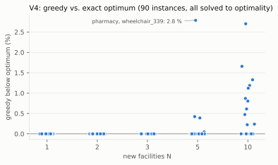
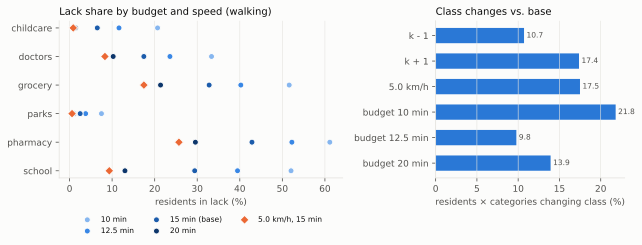
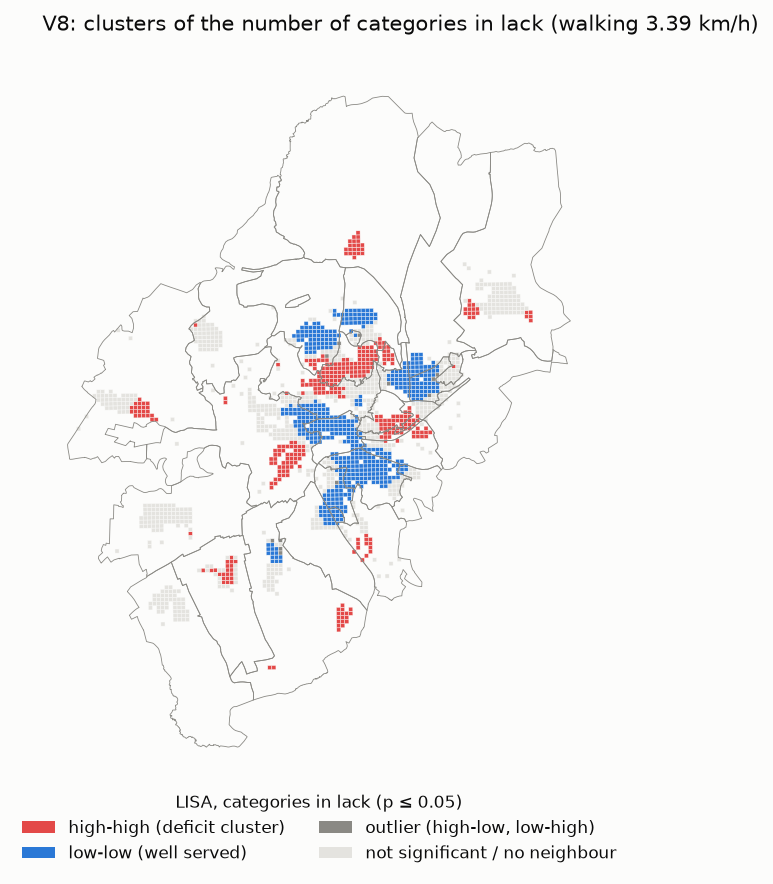
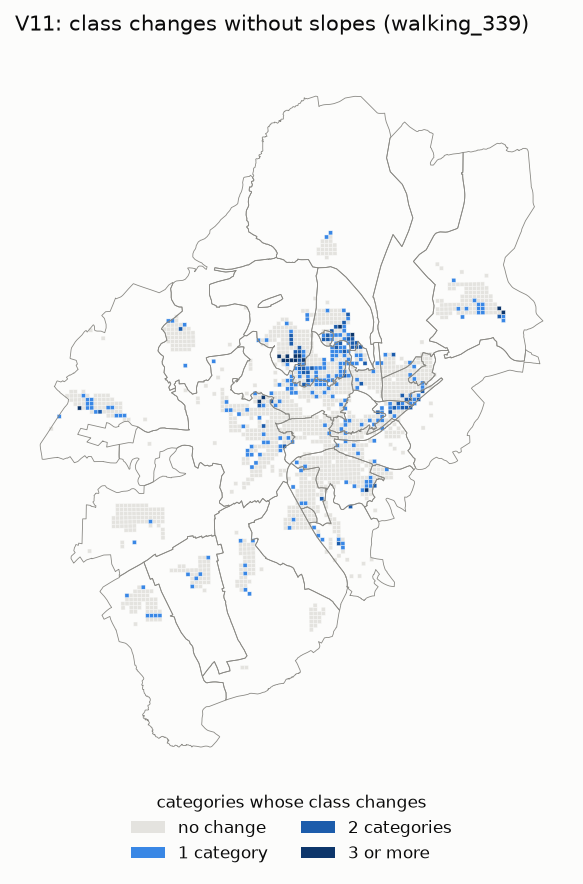

# Validation report — reach

> **Status:** v1 (6 Nov 2026), run `20261106T142630Z` (OSM snapshot of 4 Nov 2026, GTFS naldo,
> Zensus 2022). Experiments V1–V11 of [`methodology.md`](methodology.md) §6; V7 and V9 need
> people and are **manual / not yet run** (protocols below). Reproduce:
> `make experiments RUN_ID=20261106T142630Z` (about 5 minutes on a laptop; settings in
> [`config/experiments.yaml`](../config/experiments.yaml), code in
> `pipeline/src/reach_pipeline/experiments/`, results in `data/experiments/<run_id>/vNN/`,
> overview in `data/experiments/<run_id>/summary.md`).

Unless stated otherwise, numbers refer to the inclusive walking profile (3.39 km/h, 15 min,
`walking_339`) and to residents of the 1,699 scored cells (90,355 residents). "Class" means
lack / insufficient / sufficient (methodology §4). "Residents × categories changing class"
counts a resident once per category whose class changes.

## Summary

| # | Experiment | Status | Key result |
|---|---|---|---|
| V1 | Matrix vs. isochrone polygon counts | done | Polygons add 18–20 % false pairs, 47 % of them across the Neckar, rail lines or main roads; 5–6 % of cell × category classes would differ |
| V2 | OSM completeness vs. the city's lists | done | Childcare recall 87.5 %, precision 98 %; schools recall 95 %, precision 95 % |
| V3 | Recommender back-test | done | With only the removed deficit to win back, greedy recovers all of it; 80–98 % of picks lie within 500 m of a removed facility (random: 8–36 %) |
| V4 | Greedy vs. exact MILP | done | 90 full-city instances solved to optimality; greedy at most 2.8 % below the optimum (mean 0.17 %) |
| V5 | Sensitivity (k, speed, budget) | done | Lack shares move strongly with budget and speed; district rankings stay similar (median Spearman 0.78–0.95) |
| V6 | Cell centroid vs. building origin | done | 1.9 % (walking) / 2.8 % (wheelchair) of residents × categories change class; centroid is robust |
| V7 | Plausibility with local knowledge | **manual / not yet run** | Needs two or three people who know Tübingen; protocol below |
| V8 | Spatial statistics | done | Deficits are strongly clustered on the cell level (Moran's I 0.72–0.88, p = 0.001); no autocorrelation between districts |
| V9 | Reproducibility from the README | **manual / not yet run** | Needs a team member who did not write the pipeline; protocol below |
| V10 | Matrix vs. /route | done | 600 pairs: median |Δ| 0.5 s, 99.7 % within 5 s; 0 of 900 false negatives; flip rate ≤ 1 % |
| V11 | With vs. without slopes | done | Slopes change the class of 3.3–3.6 % of residents × categories, mostly on the hillsides (Winkelwiese, Wanne, Waldhäuser-Ost); `max_grade` has no effect |

Runtime and peak memory per experiment: see [Runtime and memory](#runtime-and-memory).

---

## V1 — Matrix counts vs. isochrone point-in-polygon counts

**Question.** How wrong would counting with isochrone polygons be, and where?

**Method.** 150 random scored cells (seed in `config/experiments.yaml`). For each cell and the
profiles `walking_339` and `wheelchair_339` one Valhalla isochrone for 15 minutes with the app's
simplification (`generalize` 20 m, `denoise` 0.5). A facility counts "by polygon" if any of its
routing points lies inside. Compared with the pipeline's matrix result (`reachable`). For every
pair the straight line origin → facility point is tested against OSM rivers, canals, rail lines,
motorways and trunk roads.

**Result.**

| | walking 3.39 | wheelchair |
|---|---|---|
| Pairs found by both | 3,193 | 2,823 |
| Only by polygon (over-count) | 585 (18.3 % of matrix pairs) | 570 (20.2 %) |
| Only by matrix (under-count) | 2 (0.06 %) | 4 (0.14 %) |
| Polygon-only pairs across a barrier | 47.5 % | 42.1 % |
| Pairs found by both across a barrier | 29.4 % | 29.4 % |
| Cell × category pairs with a different count | 27.1 % | 26.1 % |
| … with a different class | 5.1 % | 6.3 % |
| Residents × categories with a different class | 4.7 % | 5.3 % |

Mean over-count per cell and category: parks +1.95, doctors +0.71, childcare +0.53, grocery
+0.31, school +0.27, pharmacy +0.11. Grocery classes differ most often (10.7 % of the sampled
cells), because a second supermarket decides between insufficient and sufficient.

**Interpretation.** Polygon counting is biased in one direction: it almost never misses a
facility but adds many that are not reachable within 15 minutes. These pairs cross the Neckar,
the rail lines or main roads far more often than the pairs both methods find (47 % vs. 29 %): the polygon
bridges gaps between network branches that are only connected via a distant bridge or
underpass, and simplification smooths the outline over unreachable blocks. This confirms
decision D2 (architecture §6.3): isochrones are display only.

**Limitations.** One random sample (150 of 1,699 cells); the result depends on the polygon
simplification (the app's values are used); the barrier test uses straight lines and is only an
explanation, not a cause.

## V2 — OSM completeness vs. an official list

**Question.** Recall and precision of the facility data for childcare and schools.

**Method.** Reference: the city's own directories on tuebingen.de, the Kita list (104
facilities of all operators, incl. church, parent-run, forest and company Kitas) and the school
pages (38 schools: primary, secondary, special-needs, vocational, private). There is no
machine-readable official list: the Kultusministerium's school WFS is disabled, the Statistisches
Landesamt sells its directory, the city has no open-data portal. The pages were fetched once
(159 requests, 1 per second, 6 Nov 2026), only name, address and operator are kept in
`data/reference/` (git-ignored; the pages state no licence, so the list is used for validation
only and not redistributed). No geocoding service: each entry is placed on the OSM address
point with the same street and house number (95 of 104 Kitas, 36 of 38 schools). An entry
matches an OSM facility of the category inside the city if it lies within 100 m or has a
similar name (token Jaccard ≥ 0.5 after removing generic words such as "Kindergarten").

**Result.**

| | City list | Located | OSM in city | Recall | Precision |
|---|---|---|---|---|---|
| Childcare | 104 | 95 | 98 | 87.5 % (91 of 104) | 98.0 % (96 of 98) |
| Schools | 38 | 36 | 42 | 94.7 % (36 of 38) | 95.2 % (40 of 42) |

Missing in OSM (no match): 13 Kitas, among them *Katholisches Kinderhaus Helene von Hügel*,
*Evangelischer Martinskindergarten*, *Kinderhaus Alte Weberei*, *Kita am Neckarbogen*,
*Kinderhaus Berliner Ring*, *Partou Kita Memminger Straße*, two Waldorf Kitas and a company
Kita; one entry (*Tageselternverein Landkreis Tübingen e.V.*) is an office, not a facility.
Schools: *Bildungs- und Technologiezentrum* and *IB Berufliche Schulen*. OSM objects without a
match: one Kita (*Mömpi*) and one without a name; *Trommelschule Tübingen* (a music school
tagged `amenity=school`) and *Kinderhaus Paula Zundel* (a Kita tagged as school). Pharmacies
were checked by hand in P7: 17 public pharmacies in OSM in the city vs. about 18 in public
directories (one, *Keltern-Apotheke*, status unverified).

**Interpretation.** OSM is precise for both categories (few objects that are not real or wrongly
tagged) and nearly complete for schools. For childcare, about one in eight facilities is
missing, mostly small church-run and new Kitas in development areas (Alte Weberei,
Neckarbogen). Childcare counts are therefore conservative (more "lack" than real), but with
k = 2 and 94 % of residents already reaching at least one Kita on foot, the class changes this
can cause are limited to a few areas. The unmatched names are a concrete list for OSM edits
(a future data source would be the city's Kita list itself, if a licence is clarified).

**Limitations.** Precision is an upper estimate: in the dense centre a facility can match a
different reference entry within 100 m (21 school and 20 childcare pairs matched by distance
only). The city list covers what the city lists (no Tagespflege; schools of the city and some
others). Name matching misses renamed facilities. Only two categories are checked
automatically.

**Note (10 Nov 2026, W7a).** The pipeline now checks type tags itself: `facility_subtypes_complete`
reports how many `amenity=school` features in the city carry `school`, `school:de` or
`isced:level` (run `20261109T175743Z`: 1 of 42, 2.4 %, gate 95 %) and lists the others in
`report_inputs.json` (`facilities_without_type`). The school split in primary and secondary
schools waits for that tagging (`docs/osm_tagging.md` §6).

## V3 — Recommender back-test

**Question.** Does the recommender find plausible sites?

**Method.** Profile `walking_339`, categories grocery, pharmacy, doctors, childcare and school.
In each of 10 repetitions, 20 % of a category's facilities inside the urban boundary are
removed at random; counts drop by the removed facilities each cell reaches (`reachable`). Greedy
then picks as many zones as were removed, on the run's stored candidate catchments (all 1,566
candidates are routed; every removed facility has a candidate within 100 m). Two modes:
*all deficits* (the recommender as it runs) and *created only* (cells that already had a deficit
before the removal count as saturated, so only the deficit the removal created can be won
back). Baseline: as many random routed candidates.

**Result** (mean over 10 repetitions; "picks near" = share of picks within 500 m of a removed
facility, "recovered" = share of removed facilities with a pick within 500 m, "deficit won
back" = deficit reduction of the picks ÷ deficit the removal created):

| Category (removed) | Mode | Picks near | Random near | Removed recovered | Deficit won back | Random |
|---|---|---|---|---|---|---|
| Grocery (6 of 28) | created only | 86 % | 9 % | 75 % | 99.8 % | 12 % |
| Pharmacy (3 of 17) | created only | 87 % | 8 % | 87 % | 99.6 % | 10 % |
| Doctors (23 of 117) | created only | 80 % | 36 % | 45 % | 100 % | 38 % |
| Childcare (17 of 85) | created only | 90 % | 34 % | 59 % | 100 % | 24 % |
| School (6 of 32) | created only | 98 % | 21 % | 70 % | 100 % | 10 % |
| All five | all deficits | 13–39 % | 10–41 % | 13–39 % | 264–733 % | 89–315 % |

In *created only* greedy needs fewer zones than were removed (2.8–10.1 on average): one new zone
often covers the catchments of two removed facilities, and some removed facilities were
redundant (their cells still reach k others).

**Interpretation.** When the recommender has to repair exactly what was removed, it goes back
to the right places: 80–98 % of its picks lie near a removed site, about 5–10 times the random rate
for grocery, pharmacy and schools (doctors and childcare are dense, so random zones are often
near one too), and the picks win back the whole created deficit with fewer zones than were
removed. In normal mode it does **not** reproduce the existing sites, and it should not: it
wins back 2.6–7.3 times the created deficit because it also targets the much larger deficits
that existed before (for example the Universität and Lustnau pharmacy gaps). Existing sites
are not optimal; the back-test shows that the objective and the catchments locate needs
correctly.

**Limitations.** Removing random facilities is not the same as a facility closing (closures
are not random); candidates are the run's routed candidates; only the walking profile.

## V4 — Greedy vs. exact solution (MILP)

**Question.** How far is greedy from the optimum?

**Method.** The recommender problem for N new facilities as a mixed-integer program
(maximise Σ P_i z_i with z_i ≤ (A_i + new_i) / k, z_i ≤ 1, Σ x_j = N, x_j binary), whose
optimum is the maximal total gain ΔW. Solved with PuLP and HiGHS on the **full city
instances** (all routed candidates, the run's stored catchments), not only small ones: for
N = 1, 2, 3, 5 and 10, six categories and the three recommender profiles (90 instances).
Greedy runs without the minimum gain on the same data.

**Result.** All 90 instances were solved to proven optimality in at most 1.5 s each. Greedy is
optimal in 75 of 90 instances; the largest gap is 2.8 % (pharmacy, wheelchair, N = 5), the mean
0.17 %. For N ≤ 3 the gap is always zero. Greedy needs a few milliseconds per instance.

**Interpretation.** Greedy is practically optimal for the published top 5 (gap ≤ 2.8 %, far
better than the worst-case guarantee of 63 % = 1 − 1/e). Where the optimum differs, it swaps one
or two zones for a pair that covers the same deficit better together; for N ≤ 3 greedy always
reaches the optimum. An exact solver is not needed in the pipeline; it could be offered for "plan N sites
together".

**Limitations.** Same objective, k and catchments as the pipeline (no capacity, no costs);
larger N not tested (the app shows 5).

## V5 — Sensitivity: k_c, walking speed, time budget

**Question.** How robust are classes, rankings and recommendations?

**Method.** Base: `walking_339`, 15 min, k as configured. Scenarios: k − 1 and k + 1 for every
category (k ≥ 1); walking at 5.0 km/h (the stored `walking_500` profile, same costing); budgets
of 10 and 12.5 min derived from the stored matrix times, and 20 min by a recount of the profile
(same blocks and matrix; every V5 run also recounts at 15 min and checks that the stored counts
come out: 0 of 10,194 rows differ, `recount_reproduces_run` in `result.json`). Measured:
residents × categories changing class, Spearman correlation of the district ranking by deficit
sum (31 districts) per category, overlap of the top-5 districts, and the recommended zones
(greedy on the stored catchments for k ± 1; the stored zones of both speed profiles).

**Result.**

| Scenario | Residents × categories changing class | District ranking Spearman (min / median) | Same recommended zones (exact / within 500 m) |
|---|---|---|---|
| k − 1 | 10.7 % | 0.71 / 0.92 | 18 / 23 of 30 |
| k + 1 | 17.4 % | 0.78 / 0.88 | 10 / 16 of 30 |
| 5.0 km/h | 17.5 % | 0.55 / 0.78 | 0 / 15 of 30 |
| Budget 10 min | 21.8 % | 0.76 / 0.80 | – |
| Budget 12.5 min | 9.8 % | 0.91 / 0.95 | – |
| Budget 20 min | 13.9 % | 0.62 / 0.86 | – |

Share of residents in lack (walking 3.39): grocery 51.6 % (10 min) → 40.2 % (12.5) → 32.8 %
(15) → 21.4 % (20) and 17.5 % at 5.0 km/h; pharmacy 61.2 → 52.2 → 42.9 → 29.6 % and 25.7 %.

**Interpretation.** Absolute numbers depend strongly on the assumptions: at 5.0 km/h or with
20 minutes, the share of residents without a supermarket roughly halves. The *pattern* is
stable: districts keep their order (median Spearman 0.78–0.95), so the ranking of
underserved districts is a robust result, the absolute shares are not. Recommendations move
with k and speed, but mostly to a neighbouring zone (half to three quarters within 500 m):
the area to act in is robust, the exact 100 m cell is not. The report should therefore always
state the speed and budget next to a share, and present zones as areas.

**Limitations.** One profile; budgets are not replayed in the recommender (catchments depend on
the budget); k ± 1 changes all categories at once.

## V6 — Origin point: cell centroid vs. building-based origin

**Question.** Does the origin choice (notes N1) change the classes?

**Method.** Building origin per cell as in N1: OSM residential buildings (house, apartments,
residential, detached, semi-detached, terrace, bungalow, farm; `building=yes` only inside
residential land use) whose centroid lies in the cell, weighted by footprint; the origin is a
point inside the building closest to the weighted centroid (medoid). Recount of `walking_339`
and `wheelchair_339` with these origins (same method as `count`), compared with the run.

**Result.** 30,373 OSM buildings, 20,227 kept as residential (33 % of all buildings are
`building=yes`). 1,570 of 1,699 cells get a building origin (96.5 % of residents), the rest keep
the centroid. The origin moves by 22 m (median), 48 m (90th percentile), at most 69 m.

| | walking 3.39 | wheelchair |
|---|---|---|
| Residents × categories changing class | 1.9 % | 2.8 % |
| … to a worse class | 0.9 % | 1.0 % |
| Largest change of the lack share | parks −0.2 pp, grocery +0.1 pp | childcare −1.0 pp, parks −1.0 pp, school −1.3 pp |

Largest district changes of the deficit sum: Feuerhägle grocery +291 (+15 %), Alte Weberei
school −242, Studentendorf WHO doctors −215 (walking); for wheelchair also Österberg parks
−197 and Französisches Viertel parks −172.

**Interpretation.** The centroid is a robust origin: only about 2 % of residents × categories
change class and the changes go in both directions, so city-level and district results hardly
move. The building origin matters at the edges of the built-up area and in partly built cells
(new districts, slopes), where the centroid lies in a field or forest. Following N1's decision
rule, the small differences speak for **keeping the centroid** and documenting the robustness;
switching is a decision for the team (N1 stays open until then).

**Limitations.** Footprint area as weight (no `building:levels`); OSM building tags as they
are; the matrix blocks are formed from the new origins, so a few cells sit in other blocks.

## V7 — Plausibility with local knowledge (manual / not yet run)

**Why not run:** needs two or three people who know Tübingen, ideally not the authors.

**Protocol** (about 45 minutes per person, no prior knowledge of the project needed):

1. Open the app (`http://localhost:8080` on a machine with `make up` and a published run, or the
   hosted app) and select *walking 3.39 km/h*.
2. Open the **district panel** and note, for grocery, pharmacy and doctors, the five districts
   with the highest deficit. Do not look at the map yet.
3. Without the app: for each of these districts, answer "Do people there have a supermarket /
   pharmacy / doctor within a 15-minute walk?" on a scale 1 (no, plausible that it is missing) –
   5 (yes, there is one nearby, the result looks wrong), with a short reason (e.g. "REWE at …").
4. Now look at the map: are there areas you know to be well served that are shown as "lack",
   or areas without shops shown as "sufficient"? Note up to five, with an address.
5. Look at the top-3 recommended zones for grocery and pharmacy: is the area plausible for a new
   shop (1–5)?
6. Enter the answers in the table below (one row per person) and open a PR or send them to
   Rico.

**Expected result:** most deficit districts rated 1–2 (plausible); contradictions point to OSM
gaps (see V2) or to slopes and barriers (V1, V11) and become notes.

| Date | Person | Districts rated (n) | Mean rating (1–5) | Contradictions found (address, category) | Notes |
|---|---|---|---|---|---|
| | | | | | |

## V8 — Spatial statistics (Moran's I, LISA)

**Question.** Are deficits clustered?

**Method.** Per scored cell: the unmet share max(0, 1 − A/k) per category and the number of
categories in lack (0–6), walking 3.39. Neighbours: cells whose centres are at most 150 m apart
(queen contiguity on the 100 m grid), row-standardised; 42 isolated cells (single cells of
small Teilorte) are left out. Global Moran's I with 999 permutations; local Moran's I (LISA)
with conditional permutations, p ≤ 0.05 (no multiple-testing correction). District level: share
of residents in lack, districts as neighbours when they touch. NumPy only (methodology M5
proposes Moran's I; confirmation by the supervisors is still open).

**Result.** Cell level, Moran's I (all p = 0.001, expected −0.0006): grocery 0.88, doctors 0.86,
pharmacy 0.86, school 0.79, childcare 0.77, parks 0.72; number of categories in lack 0.88.
LISA: 362 cells (12,917 residents) in high-high clusters (many categories in lack, neighbours
too), 520 cells (42,478 residents) low-low, 12 outliers, 763 not significant. Largest high-high
populations: Schönblick/Winkelwiese 3,277, Universität 1,849, Weststadt 1,730, Österberg 964,
Unterjesingen 950, Kilchberg 856. District level: no significant autocorrelation except a
weak negative one for parks (I between −0.13 and −0.03; parks −0.11, p = 0.03; 31 districts).

**Interpretation.** Deficits are not scattered: they form contiguous areas — the hillside
neighbourhoods north of the centre (Winkelwiese, Universität/Schnarrenberg, the upper
Weststadt, Österberg) and the outlying Teilorte — next to a large well-served core along the
Neckar and in the Südstadt. Between districts there is no pattern (a deficit district is not
more likely to border another), because the districts mix served and unserved parts and the
Teilorte are separated by open land. Aggregating to districts hides the clusters; the map and
the cell-level view are needed.

**Limitations.** Strong autocorrelation is partly built in (neighbouring cells share most of
their catchment); the cluster boundaries depend on the neighbour distance; LISA p-values are
not corrected; 31 districts give little power.

## V9 — Reproducibility from the README (manual / not yet run)

**Why not run:** must be done by a team member who did not write the pipeline (Socke or Juju).
The clean-checkout test of 6 Nov 2026 (implementation plan §7) was done by the author and
does not count; its gaps were fixed in PR #32.

**Protocol** (about 1 hour, a machine with Docker, uv, osmium-tool; nothing else installed from
the project):

1. In a **new folder**, follow `README.md` "Getting started" only — do not read the code or ask
   the authors. Use another `COMPOSE_PROJECT_NAME` and other ports in `.env` if a stack already
   runs (README).
2. Note each step that is unclear or fails (command, error, what you did).
3. `make up`, `make migrate`, `make refresh`: note the run id and the runtime; open
   `data/runs/<run_id>/validate_results/report_results.md` — `status` must be `ok`.
4. Open `http://localhost:<WEB_PORT>`: the map must show cells; click one cell, note the
   grocery count for *walking 3.39*.
5. Compare with the reference run `20261106T142630Z` (this report): grocery lack share 32.8 %
   (walking 3.39) on the *Data & validation* page or in `report_results.md`. Same OSM snapshot →
   identical; a newer snapshot → small changes (in P7 a new snapshot changed 0.63 % of counts).
6. **Newer snapshot:** at least a week later, run `make refresh` again in the same checkout;
   note the new run id, whether the tiles were rebuilt and whether `validate_results` is `ok`.
7. Enter the result below.

**Expected result:** steps 1–6 succeed without help; runtime about 12 minutes per refresh
(download about 350 MB the first time).

| Date | Person | Snapshot / run id | Steps without help (of 6) | Problems (step: what) | Runtime | validate_results |
|---|---|---|---|---|---|---|
| | | | | | | |

## V10 — Matrix vs. /route

**Question.** How often does the matrix decide differently from a single route near the budget?

**Method.** The checks of `validate_results` (report part 2, every run) with larger samples:
200 reachable pairs per profile (80 % with a matrix time ≥ 12 min) compared with /route, and 50
unreached pairs per profile and category within the prefilter reach routed with /route; profiles
walking 3.39, walking 5.0, wheelchair (cycling left out). Same functions, same Valhalla config
as `count` (checked).

**Result.**

| | Run report (every run) | V10 |
|---|---|---|
| Matrix vs. /route pairs | 100 (4 profiles), mean |Δ| 0.4 s, max 1 s | 600, mean |Δ| 1.4 s, median 0.5 s, 99.7 % within 5 s, max 391 s |
| Counted pairs beyond the budget by /route | 0 | 4 of 600 (walking 3.39: 2, walking 5.0: 1, wheelchair: 1) |
| False negatives (uncounted, but /route within budget) | 0 of 480 | 0 of 900 (22 wheelchair pairs without any route) |
| Highest flip rate per profile and direction | 0.0 % | 1.0 % (walking 3.39, matrix within → route beyond) |

**Interpretation.** The matrix and /route agree to the second for almost all pairs. The few
pairs that flip lie within seconds of the budget or are parks whose nearest routing point
differs; the direction is "matrix counts, route says just beyond", so counts are at most very
slightly optimistic. No missed facilities were found (N9 settled).

**Limitations.** /route is also Valhalla (no independent ground truth); samples, not all pairs.

## V11 — With vs. without slopes

**Question.** How much do slopes change the classes, and where?

**Method.** A one-off elevation-free tile set built from the run's clipped PBF (same SHA-256 as
the production tiles, `tiles_match_run`) in a temporary container of the pinned Valhalla image
(3.9.1), served on 127.0.0.1:8005 next to the demo stack and removed afterwards. Recount of
walking 3.39, walking 5.0 and wheelchair there, compared with the run (with slopes). Golden pair
Marktplatz → Schloss on both, and the wheelchair route with `max_grade` unset, 1, 6, 12 and 30
(notes N11 option b).

**Result.** Build 8.3–8.7 s, peak 187–226 MB, 11.4 MB of tiles (three runs); the temporary
Valhalla peaked at 1.41–1.44 GB during the recount (75–85 s for three profiles); container and
tiles removed.

| | walking 3.39 | walking 5.0 | wheelchair |
|---|---|---|---|
| Residents × categories changing class | 3.6 % | 2.4 % | 3.3 % |
| … better without slopes / worse | 17,661 / 1,627 | 11,464 / 1,552 | 15,184 / 2,788 |
| Lack share childcare with / without slopes | 6.5 → 4.4 % | 0.9 → 0.6 % | 10.0 → 8.2 % |
| Lack share school | 29.4 → 26.5 % | 9.3 → 7.4 % | 33.8 → 31.1 % |
| Lack share grocery | 32.8 → 31.1 % | 17.5 → 16.0 % | 37.3 → 35.5 % |

Largest drops of the deficit sum without slopes (walking 3.39): Schönblick/Winkelwiese −1,675,
Wanne −1,452, Studentendorf WHO −1,363, Universität −1,071, Waldhäuser-Ost −1,023. Golden pair
(12 % grade): 681 s with slopes, 568 s flat (−17 %), same 506 m route. `max_grade` does not
change the wheelchair route or time on either tile set.

**Interpretation.** Slopes matter where Tübingen is steep: the hillside districts north of the
centre lose most from them, the valley and the Südstadt hardly change. City-wide, 3–4 % of
residents × categories would be classed better on a flat-ground model; a few are classed worse,
because Valhalla's slope model also speeds up gentle downhill sections (methodology §1). The
results with slopes are the realistic, conservative ones and stay the default (N5). N11 (b):
`max_grade` has no effect in Valhalla 3.9.1 (also not on flat tiles), so the wheelchair profile
cannot exclude steep edges this way; the methodology's known limitation stands.

**Limitations.** Valhalla's slope model is one model (no calibration against measured walking
times); flat tiles only remove elevation, the graph is identical.

## Runtime and memory

`make experiments RUN_ID=20261106T142630Z` on a MacBook (arm64), demo stack running:

| # | Runtime (s) | Peak RSS (MB) | Main cost |
|---|---|---|---|
| V1 | 3 | 847 | osmium (barrier lines), 300 isochrones |
| V2 | 8 (first run: + 168 s for 159 page requests) | 1,078 | osmium (address points) |
| V3 | 1 | 345 | – |
| V4 | 30 | 575 | 90 MILP solves (HiGHS) |
| V5 | 58 | 274 | 15-minute check recount, 20-minute recount |
| V6 | 47 | 861 | osmium (buildings), two recounts |
| V8 | 1 | 479 | 999 permutations |
| V10 | 7 | 323 | 1,500 /route calls |
| V11 | 87 | 183 (Valhalla container: 1,424) | tile build, three recounts |
| **Total** | **about 255** | | `make experiments`, incl. summary and figures |

The peaks above 800 MB come from osmium children (`tags-filter` on the clipped PBF; arch.
§11, notes N12), not from the experiments themselves.

## Deviations from methodology §6 (not yet in `methodology.md`)

`methodology.md` is unchanged; updating §6 needs Rico's confirmation (AGENTS.md). Differences
between §6 and what was run:

- **V4:** full-city instances instead of only "small instances" (they solved in seconds, the
  stronger test), solver HiGHS instead of CBC (§6: "e.g. PuLP/CBC"; PuLP's bundled CBC does not
  run on arm64 macOS).
- **V2:** the city's Kita and school pages instead of an "official list" from the state (no
  machine-readable state list is available, see V2).
- **V11:** §6 still calls it "planned, P7"; it is done.
- **V3:** an additional mode `created_only` next to the plain back-test.
